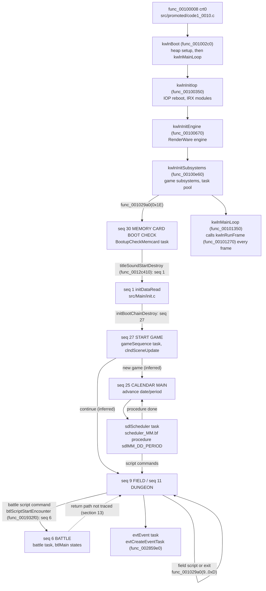

# Persona 4 engine architecture

This is a map of how the game's major systems fit together, traced from the
entry point through the recovered C. It is meant for someone who wants to
learn how Persona 4 works from this decompilation, and it is a starting point
for reading code, not a specification.

Every statement cites the file and function it was read from. Many engine
functions are still unnamed, so some citations are `func_XXXXXXXX` symbols; the
suffix is the function's retail address. Data that is not yet declared in C
is cited by its retail address (`0x5DCC20`) and was read from the retail
executable. Anything marked **[inferred]** is a reading of the code's shape
or of nearby evidence, not a traced fact. Section 13 lists the systems that
are still too unnamed to explain properly.

Names in this document were checked against the tree when it was revised. A
`func_` name can go stale when a function is renamed. To resolve one, search
for its marker `// FUN_XXXXXXXX` (section 1); the definition below the marker
has the current name.

## 1. Reading conventions

A few idioms appear in almost every first-party file. Knowing them makes the
rest of the code much easier to read.

| Idiom | What it is | Where to see it |
|---|---|---|
| `// FUN_XXXXXXXX` | Marker placed on the line above a function's definition. It records the retail address, so the function can be found from the address. | Every first-party unit, e.g. `src/Battle/battle_inferred_001927c0.c` |
| `kAssertFail(file, line)` | Assertion-failure hook. The retail body is empty, but callers still pass a source-file string and a line number. | `src/promoted/code1_0046.c` |
| `kAssertFailAt(msg, file, line)` | Assertion hook that also takes a message. Its body is empty too. | `src/promoted/code1_0046.c` |
| `chkmemAllocSiteTag(file, line)` | Allocation-site tag that callers issue before an allocation. Its body is empty. | `src/Kernel/sdkChkmem.c` |
| `func_00440b68(fmt, ...)` | Formatted debug output, for example `"Scene data load..."` in `fieldSceneLoad`. Still `INCLUDE_ASM`, in `src/middleware/middleware_inferred_004401c8.c`. **[inferred]** printf-like | `src/middleware/middleware_inferred_004401c8.c` |
| `jtbl_008873E8[0](size, hint)` | Allocate | e.g. `src/Scene/resrcManager.c` `resrcMngCreate` |
| `jtbl_008873EC[0](ptr)` | Free | e.g. `resrcMngDestroy` |
| `D_008873F4[0](count, size, hint)` | Zeroing allocate (calloc) | e.g. `src/Main/sequence.c` `func_001028c0` |
| `*(u8 **)(task + 0x38)` | The task's work block (`SdkTask::work` in `include/sdktask.h`) | every task update function |
| `iGpffffXXXX` | A small global reached through `$gp`. Its address is `0x007690F0 + (XXXX - 0x10000)`. | e.g. `iGpffffb3ac` is the battle context at `0x76449C` |

The assertion hooks are why so many units have their original names. The
`__FILE__` strings survive in the data even though the hooks do nothing (see
`tools/tu_audit.py`).

The allocator slots at `0x8873E8..0x8873FC` are `.bss`, filled at run time.
`src/Scene/resrcManager.c`'s port comment identifies `0x8873EC` as
RenderWare's `RwFree` slot, and boot hands the game's allocator table to
`RwEngineInit` (section 2). **[inferred]** The slots follow RenderWare 3.7's
memory-function layout (malloc, free, realloc, calloc, then two free-list
slots at `0x8873F8`/`0x8873FC`) wrapped around the game heap.

### Decoding retail tables

Several tables are read from the executable image, not from C declarations.
The retail image is `image.bin` at the repository root. A virtual address
(VA) maps to the image at file offset `VA - 0x100000`. Pointers stored in a
table are VAs, and strings are NUL-terminated. The decodes below were checked
against `image.bin`:

- the script command group table at `D_00748530` (section 9)
- the sequence table at `0x5DCC20` (section 3)
- the battle state table at `0x5F7180` and the battle action table at
  `D_005F6E20` (section 8)
- the battle camera table at `0x5F74E4` (section 8)

## 2. Boot and the main loop

### Entry and C entry

`config/target.json` gives the entry point as `0x00100008`. That address is
`func_00100008` in `src/promoted/code1_0010.c`. It is Sony's `crt0` and stays
`INCLUDE_ASM`; the comment above it explains why. Among the addresses it
loads are the `$gp` value `0x7690F0` and the C entry, and its last call is
`kwlnBoot` (`func_001002c0`).

`kwlnBoot` passes two strings to `func_00440b68` (debug output), calls
`func_00100230` and enters `kwlnMainLoop` (`func_00101350`). `func_00100230`
computes an address from `0x02000000` (the top of the 32 MB of RAM) minus the
image extent and passes it to `func_0043ece8`, which is still `INCLUDE_ASM` in
`src/promoted/code1_0043.c`. **[inferred]** That call initialises the C heap.

`kwlnMainLoop` is the real `main`:

1. `kwlnInitIop` (`func_00100350`) reboots the IOP with `IOPRP310.IMG` and
   loads the IRX modules from `cdrom0:\LIB31\`, retrying each until it
   succeeds. The module names in `0x5DC560..0x5DC730` include `SIO2MAN`,
   `PADMAN`, `CRI_ADXI` and the sound drivers.
2. `kwlnInitEngine` (`func_00100670`) starts RenderWare. It calls
   `RwEngineInit(func_0044f510(), 0, 0x800000)`, where `func_0044f510` returns
   the game's memory table (slots `chkmemAllocate`, `chkmemFree`,
   `chkmemReallocate`, `chkmemAllocZeroed` in `src/Kernel/sdkChkmem.c`). It
   then attaches plugins (`RpUVAnimPluginAttach`, ...), calls `RwEngineOpen`,
   `RwEngineSetVideoMode(0x52)` and `RwEngineStart` (`func_003e8b10`,
   `func_003e8a10`, `func_003e8a50` in `src/renderware/`), and registers the
   `bmp` and `tmx` image formats through `func_003eb1f0`.
3. `kwlnInitSubsystems` (`func_00100e60`) brings up the game: the task pool
   (`kwlnTaskInitPool(0x190)`, section 4), the CD service (`H_Cdvd_InitDevices`,
   `func_004559b0`, in `src/Kernel/sdkCdvd.c`), the sound service (`func_00458fa0`
   in `src/sdkSnd.c`), the Sofdec player (`mwPlyInitSfdFx`),
   `btlUnitLoadSyncedAssets` (`func_001939a0`), the script pools (`scrInitPools`,
   `func_0029d950`), the two `mainDraw` tasks (`mainDrawStartClearOt`,
   `mainDrawStartFrame`), the sequence observer (`func_001028c0`) and the fade
   task (`func_00122430` in `src/fade.c`). It also calls
   `func_001029a0(0x1E, 0, 0, 0)`, which requests game sequence 30.
4. It seeds `RpRandomSeed` and `RpRandomSeedMT` from the timer at
   `0x10000000`, then calls `kwlnRunFrame` (`func_00101270`) forever.

### The frame

`kwlnRunFrame` (`func_00101270`) in `src/Kernel/Kwln/kwln_inferred_00100e30.c`
is one frame. In order, it calls:

| Call | Owner | Role |
|---|---|---|
| `H_Cdvd_UpdateRequests` (`func_00454640`) | `src/Kernel/sdkCdvd.c` | Services the queue of disc reads (section 5) |
| `resourceLoadSprites` (`func_0046ab40`) | `src/promoted/code1_0046.c` | Walks the sprite attachment list at `D_00724C08` and calls `sdkSpriteLoadStep` on each entry |
| `func_0045b7c0` | `src/sdkSndcom.c` | Sound command service |
| `sdkSndUpdate` (`func_004594c0`) | `src/sdkSnd.c` | Sound service |
| `sdkPadUpdateAll` (`func_00452ce0`) | `src/Kernel/sdkTask_inferred_00452ce0.c` | Updates the two 0x4A-byte records at `D_008C02E0`. **[inferred]** controller ports |
| `kwlnTaskRunFrame` | `src/Kernel/sdkTask.c` | Runs every task (section 4) |
| `func_00466580` | `src/h_sfdply.c` | Resumes the Sofdec movie thread when it is pending |
| `func_003e5510(1)` | `src/promoted/code1_003e.c` | Sets `D_00886700` |

`kwlnRunFrame` also increments two counters at `iGpffffb1a0` and
`iGpffffb19c`. Nothing is drawn directly in the frame function. Drawing
happens inside tasks (section 6).

## 3. Game sequences

A *sequence* is the top-level mode the game is in: field, battle, calendar,
title, a shop and so on. `src/Main/sequence.c` owns the switch:

- `func_001028c0` creates the **sequence observer** task. Its name string
  `"sequence observer"` is at `0x5DCB40`. It has priority `0xF`, update
  `FldShadowAnim_Update` and destroy `FldShadowAnim_Destroy`, the last two in
  `src/promoted/code1_0010.c`.
- `func_001029a0(id, data, size, delay)` requests sequence `id`:
  1. If a sequence is running and its *isRunning* callback still returns 1,
     the function calls that sequence's *end* callback.
  2. With `delay == 0` it calls the new sequence's *start* callback at once,
     passing `data`.
  3. Otherwise it copies `size` bytes of `data` into a fresh allocation, and
     the observer starts the sequence after `delay` frames.
- `FldShadowAnim_Update`, the observer's update, counts the delay down, calls
  *start*, and then polls *isRunning* every frame. When *isRunning* stops
  returning 1, the sequence id is reset to −1.
- `func_00102980` returns the current sequence id. Field code uses it to tell
  which mode it is in (`src/Kosaka/Field/k_field.c` `FldRootDestroy`).

The sequence table is raw data at `0x5DCC20`. Each `0x50`-byte record holds
`name[0x40]` (NUL-terminated), a flag word at `+0x40`, and the *start*,
*isRunning* and *end* callbacks at `+0x44`, `+0x48` and `+0x4C`. Decoding the
records from `image.bin` (section 1) reproduces the names and callbacks in the
table below for ids 0 to 30.

Nearly every *isRunning* callback is "find the task by name". Nearly every
*end* callback destroys that task. Most of these callbacks live in
`src/Kosaka/Field/sequenceList.c` (the `Seq*` callbacks, from
`SeqInitDataRead_End` to `SeqMovie_End`) and `src/promoted/k_sequence.c`.

| Id | Retail name | Start callback (owner) | Notes |
|---|---|---|---|
| 0 | (none) | `SeqDebugMenu_Start` (sequenceList.c), which calls the empty `func_00103590` | Polls for the `"debug menu"` task, which is stripped from retail |
| 1 | (none) | `FldBootChain_Start`, which calls `initBootChainStart` (`src/Main/init.c`) | `initDataRead`: loads the init tables |
| 2 | FIELD (EVENT) VIEW | `K_SeqFieldViewerStart` | Viewer mode |
| 3 | DUNGEON VIEW | `K_SeqDungeonViewerStart` | Viewer mode |
| 4 | DUNGEON EDITOR | `K_SeqMapEditStart` | Viewer mode |
| 5 | LARGE MAP DEBUG | `K_SeqLmapStartFlagged` | Debug mode |
| 6 | BATTLE | `K_Fldrc_DestroyArchives`, which calls `btlTaskCreate` (`func_00192e90`) and `btlSetFreeUnitsOnTeardown` (`func_00193730`) in `src/Battle/battle_inferred_001927c0.c` and `battle_inferred_00193630.c` | See section 8. End callback `SeqBattle_End`. |
| 7 | SCRIPT VIEWER | `SeqScriptViewer_Start`, which calls `scrCreateScriptChildTask` (`func_0029e8d0`, `scrScriptProcess.c`) | |
| 8 | EVENT | `SeqEvent_Start`, which calls the stub `func_002853b0` | |
| 9 | FIELD | `K_SeqFieldRecordStart` (`src/promoted/k_sequence.c`), which calls `FldRootCreate` (`k_field.c`) | 0x1C-byte packet: field, room, entry, spawn, direction |
| 10 | TOOL EVENT | `K_SeqFieldPosStart` | |
| 11 | DUNGEON | `K_SeqFldStepStart`, which calls `FldStepTaskCreate` (`func_00159e90`, `src/promoted/code1_0015.c`) | |
| 12 | LARGE MAP | `K_SeqLmapStart` | |
| 13 | FOOD COURT | `K_SeqFoodCourtStart` | |
| 14 | KOSAKA | `K_TestMenu_Create` | Per-programmer test entry. **[inferred]** These match the `src/Kosaka/` and `src/Yajima/` directory names. |
| 15 | TOHYAMA (MOVIE) | `func_00143b70` | Test entry, unnamed |
| 16 | NIIDA | `mdlNeckTestStart` | Test entry |
| 17 | YAJI | `SeqYaji_Start` | Test entry |
| 18 | NOWATARI | `SeqNowatari_Start` | Test entry |
| 19 | MIWA | `func_002466d0` | Test entry, unnamed |
| 20 | IMANISHI (STAFF) | `func_0038dd60` | Test entry, unnamed |
| 21 | SAMPLE | `SeqSample_Start` | Test entry |
| 22 | WEAPON STORE | `SeqWeaponStore_Start`, which calls `func_002bdb50` (`src/Event/Fcl/y_fclShop.c`) | Polls `Y_FclShopMainProc` |
| 23 | ITEM STORE | `SeqItemStore_Start`, which calls `shopSystemCreate` (`func_002e7510`, `src/promoted/code1_002e.c`) | Polls `46ShopSystem` |
| 24 | COMBINE | `SeqCombine_Start`, which calls `fclCombineTaskCreate` (`func_00311260`, `src/Event/Fcl/y_fclCombine.c`) | Polls `Y_FclCombineTitleProc` |
| 25 | CALENDAR MAIN | `calendarOpenFlagClear` (`src/calendar.c`) | Section 10 |
| 26 | CALENDAR (RESTART) | `calendarOpenFlagSet` (`src/calendar.c`) | |
| 27 | START GAME | `gameSequenceStart` (`src/Main/gameSequence.c`) | Task `"gameSequence"` with update `clndSceneUpdate` |
| 28 | NAME ENTRY | `timeLimitStart` (`func_00103510`, `src/promoted/code1_0010.c`), which calls `timeLimitTaskCreate` (`func_002a2650`, `src/nEntry.c`) | |
| 29 | MOVIE | `SeqMovie_Start`, which calls `mwPlayerCreate` (`func_0046a110`, `src/promoted/code1_0046.c`) | Also requested by a script command in `src/Script/scrCommonCommand.c` |
| 30 | MEMORY CARD BOOT CHECK | `SeqMemcardBootCheck_Start`, which calls `titleStartSoundTask` (`func_0012c460`, `src/promoted/code1_0012.c`) | Task `"BootupCheckMemcard"` |

### Boot chain

1. Init requests sequence 30. `titleStartSoundTask` (`func_0012c460`) creates
   the `BootupCheckMemcard` task. Its destroy callback `titleSoundStartDestroy`
   (`func_0012c410`) frees the task's work block and requests sequence 1 with a
   5-frame delay.
2. Sequence 1 runs the `initDataRead` task (`src/Main/init.c`
   `initBootChainStep`). It calls three step callbacks from `0x5E46D0` in turn
   (`initDataReadStart`, which reads `init/itemtbl.bin` into `D_0079BF00`;
   `func_0012d320` in `src/Camp/cmpMain.c`, named `cmpAssetLoaderTaskCreate`;
   `FldStartupDataCreate` in `src/promoted/k_fldData.c`), each returning a task,
   and waits for each task to reach the dying state. Then
   `initBootChainDestroy` requests sequence 27 with a 5-frame delay.
3. Sequence 27 runs `clndSceneUpdate` in `src/promoted/code1_0012.c`, which
   either requests sequence 25 (calendar) or resumes at a saved location
   through sequence 9 (field; `D_0079B698`/`D_0079B69C` are field and room)
   or sequence 11 (dungeon; `D_0079B6A0`). **[inferred]** These correspond to
   the title menu's new-game and continue choices.

## 4. The task kernel

Everything that runs per frame is a task. The kernel is
`src/Kernel/sdkTask.c`. The P3 FES names `kwlnTask*` in
`config/symbol_names.p3.txt` belong to it, and the kernel functions use them: `kwlnTaskGetTaskByName` and `kwlnTaskDestroyWithHierarchy`. Note
that `src/Kernel/kwlnTask.c` itself holds two camera helpers, not the kernel.

### The task object

The object is `struct KwlnTask` in `sdkTask.c`, `0x54` bytes. A smaller
public view, `SdkTask`, is in `include/sdktask.h`. The fields that matter:

| Offset | Field | Meaning |
|---|---|---|
| `0x00` | `name[0x18]` | Inline name; tasks are found by name |
| `0x18` | `nameSum` | Sum of the name bytes, compared before `strcmp`-style matching in `kwlnTaskGetTaskByName` |
| `0x1C` | `flags` | Low nibble is the list state (1 starting, 2 active, 3 dying). Bit `0x20` skips updates. Bit `0x10` gives the task a neutral input block (zeroed, with `0x80` in the analog fields). |
| `0x20` | priority | Sort key; lower runs first |
| `0x2C` / `0x2E` | start delay / free delay | Frames spent in the starting and dying lists. The free delay is at least 2. |
| `0x30` | update | `SdkTaskUpdate`, `s32 (*)(u8 *task)` |
| `0x34` | destroy | `SdkTaskDestroy` |
| `0x38` | `work` | Caller-owned work block |
| `0x48`/`0x4C`/`0x50` | parent / first child / next sibling | Task hierarchy |

### Creation

`kwlnTaskCreate(name, priority, startDelay, freeDelay, update, destroy, work)`
creates a task; the prototype is in `include/sdk_task_registration.h`. It
allocates the object from the pool built by `kwlnTaskInitPool`. That pool is
`RwFreeListCreateAndPreallocateSpace(0x54, 0x190, ...)`: 400 task slots. The
symbol is `func_003e1220`, which `src/renderware/core/bacamera.c` `#define`s
to the RenderWare name.

A task with no start delay goes straight onto the active list.
`kwlnTaskCreateChild(parent, ...)` does the same and then links the new task under
`parent` with `kwlnTaskAddChild`.

### Running

`kwlnTaskRunFrame` is the per-frame entry. It runs in three passes:

1. Counts down start delays and moves tasks whose delay has expired onto the
   active list.
2. Calls `kwlnTaskRunList`, which walks the active list in priority order. For
   each task, `kwlnTaskRunUpdate`:
   - prepares the 0x94-byte input block at `D_008C0240`, copied from
     `D_008C02E0`, or neutral when flag `0x10` is set
   - calls `update`
   - increments the frame counter at `0x28`, which `kwlnTaskGetTimer` reads
3. Counts down free delays on the dying list and finalises tasks whose delay
   has expired (`kwlnTaskFinalize`).

The update's return value drives the task:

| Return | Effect |
|---|---|
| `0` | Keep running |
| `-1` | End the task: move it and its children to the dying list (`kwlnTaskMoveToDying`, `kwlnTaskKillSiblingChain`) |
| Any other value | Becomes the new update function, so a task can switch state by returning the next handler |

### Lifetime

`kwlnTaskDestroyWithHierarchy` moves a task and its
children to the dying list. When the free delay reaches zero,
`kwlnTaskFinalize` ends the task's children, unlinks the task, calls `destroy`
and returns the slot to the free list.

`kwlnTaskGetState` reports a task's list state. `kwlnTaskIsLinked(task)` returns 1
while the task is still on any list, which is how callers poll for a task to
finish. `init.c` and `calendar.c` wait instead for a child to reach state 3.
`kwlnTaskDumpAll` prints the task tree, and is a useful reference for the list
globals.

### Priorities seen in this document

`0x0A` mainDraw "clear ot"; `0x0F` sequence observer, field root, evtEvent;
`0x10`/`0x11` battle and its draw children; `0x98`/`0x99` fadeCalc and
fadeDraw; `0xC8` mainDraw(drawOt); `0x100` gameSequence, Calendar,
initDataRead, sdlScheduler and ItemTblDataRead.

## 5. Memory, resources and disc loading

### Heaps

`src/Kernel/sdkChkmem.c` is the checked allocator that RenderWare is given
at boot; `chkmemAllocate` rounds sizes up and keeps the allocation count and
byte total in `D_00763D1C`. `src/promoted/code1_0046.c` `poolAlloc` (`func_0046a430`) is a
second allocator (the file-name string `sdkMalloc.c` at `0x713088`) that hands out
16-byte-aligned blocks from a slot table at `iGpffffbb14`;
`src/Kernel/h_malloc.c` `H_Calloc` wraps it. The rest of `h_malloc.c` is
unrelated GS texture-upload packet builders (`gsUploadRasterTiles` at
`func_00143ba0` and `gsPackTrxDir` at `func_001441a0`).

### The scene and its resource lists

The current scene is the `MtScene` object at `iGpffff9db0` (`0x762EA0`),
typed in `src/Scene/mt_scene.c` as `fldMajorId`, `fldMinorId` and
`resManager` (offsets 0, 4 and 8). `src/promoted/code1_0014.c`
`fieldSceneLoad(major, minor)` loads a scene. If that major/minor is already
loaded it prints `"Scene data cashe hit!!"` and reuses it. Otherwise it frees
the old scene (`fieldSceneUnload`, `func_00145080`, which calls
`resrcMngDestroy`), creates a new manager with `resrcMngCreate`, and creates
the default character and NPC lights (`MT_Scene_CreateResLightChar`,
`MT_Scene_CreateResLightNpc`). The pack file path is built by
`fieldRoomFileExists` (`func_00144b80`) from `D_005EF7C0`, two formatted parts
and a suffix. The function then returns whether `H_Cdvd_FileExists` finds the
file. The field-band test that follows assigns the same value, so the return
is the existence result.

`src/Scene/resrcManager.c` keeps one doubly linked list per resource type
(`ResrcManager::resLists[22]`). A resource id is a `u16`: the low 10 bits are
the id and the upper bits are the `ResrcType` (`RESRC_TYPE_MODELCHAR = 1`,
`RESRC_TYPE_FLD`, `RESRC_TYPE_FLDHIT` and so on, from
`include/resrc_manager_internal.h`). `resrcMngCreateRes` allocates a record
of the type's size and links it; `MT_Scene_GetRes(resTypeId)` finds one; and
`MT_Scene_GetResListHead(type)` returns a type's first record, for walking
the `next` link at `0x138`. The field frame state that the field code reads
is returned by `MT_Scene_GetFrameState` (`src/promoted/code1_0015.c`); its
type is `FldFrame` (`include/field_frame_internal.h`).

Callers include battle (`src/Battle/battle.c` `btlFindFreeCharResId`, which
probes ids `0x400|n`), the field (`k_field.c` `FldRootUpdate`), events
(`src/evtScript.c`) and social-link screens (`src/cmmRankUp.c`).

### Disc loading

`H_Cdvd_AcquireDirectory` (`func_00454a60`, `src/Kernel/sdkCdvd.c`) takes a
`path` and `mode` and returns an `HCdvd` request. It upper-cases the path,
resolves it against the volume directory table `D_007107b0` in
`src/h_cdvd/h_cdvd.c`, and links a `0x364`-byte node into the list at
`D_008D1B80`. A path that is already queued is shared and reference-counted at
`0x35A`.

`H_Cdvd_UpdateRequests` (`func_00454640`), called first in every frame,
advances each node's `readState`. It opens the file through CRI's ADX file
system (`ADXF` handles; `func_004c85a0` and friends in `src/cri/`), allocates
`fileMemory`, and reads.

Callers poll `H_Cdvd_IsFileLoaded`, or block with `H_Cdvd_ReadSync`, read
the data at `+0x110` (pointer) and `+0x118` (size), then release it with
`H_Cdvd_Destroy`. All three are in `src/h_cdvd/h_cdvd.c`. `src/Main/init.c`
`initDataReadStep` is the smallest complete example.

## 6. Rendering

The game renders through RenderWare Graphics 3.7. `src/renderware/` is the
ported source; `src/rw/` holds other attributed RenderWare functions and the
PS2 "sky" driver. `wiki/RenderWare.md` explains the split.

`src/rw/` names follow three rules. A copy whose address `src/renderware/`
already binds through a `#define` alias keeps its address name, because
renaming it would break that alias and `src/renderware/` is outside the
graphics lane. A copy at an address that `src/renderware/` also defines by
name keeps its address name too: the two trees describe one function, and a
second RenderWare name would make the duplicate look like a separate API.
Any other `src/rw` function takes a RenderWare or driver name only with
retail evidence (an assert string, a plugin ID, or a known API shape) and a
body that agrees with it. Names from other games' symbol tables stay hints
in `docs/sky2/` until the body is confirmed.

### The ordering table

Each frame is bracketed by two tasks created in `src/Main/mainDraw.c`:

1. **`"clear ot"`**: `mainDrawStartClearOt`, priority `0x0A`, update
   `mainDrawClearOtUpdate`. It flushes debug print (`H_Dbprt_Flush`), clears the
   camera (`RwCameraClear`), resets the ordering table at `D_00793E80`
   (`PrimClearNodes`, was `func_00460a80`; `0xD8` buckets of `0x30` bytes), and installs fixed
   render-state callbacks (`func_001015c0`..`func_00101a80`) into specific
   buckets.
2. Game tasks then append draw nodes to buckets. `src/sdkOt.c`
   `PrimAppendNode` (was `func_00460ac0`) appends a node to a bucket, and
   `PrimQueueStateSet` (was `func_00460b60`) allocates a node with a callback
   and an argument. For example, battle registers
   `btlRenderStateSetup` and `btlSkyScroll` into buckets `D_007940C0` and
   `D_00794120` (`src/Battle/battle.c` `btlUpdateDraw3DTask`).
3. **`"mainDraw(drawOt)"`**: `mainDrawStartFrame`, priority `0xC8`, update
   `mainDrawFrameUpdate`. It brackets the walk with the camera's begin/end-update
   (`func_003e8120` and `func_003e8110` in `src/rw/bacamera.c`, which call
   camera slots `0x18` and `0x1C`). In between it calls `sdkOtFlushBuckets` (was `func_004623a0`) on
   each of the `0xD8` buckets in order.

**[inferred]** The function table at `D_00887300` is RenderWare's
render-state setter. Every draw callback calls it as `(state, value)`, next
to `RpSkyRenderStateSet`.

### Models

`src/Graphics/Model/mdlManager.c` is the model layer over RenderWare clumps
and `RpHAnimHierarchy` animation, ported in part from P3 FES; its named entry
points so far are `mdlGetClump`, `mdlGetClumpFrame`, `mdlGetMatrix`,
`mdlScale` and `mdlSetColor`. `mdlCreateModelObjectFromData` (was
`func_00477e80`) and `mdlTranslateMatrix` (was `func_0047a180`) are also named
there. `src/Graphics/Model/mdlApp.c` `mdlAppBindObjectRecord` (was `func_00230f20`)
picks the file for a model by type and id, including date-dependent
variants (`datGetDateIndex`, `src/g_data/g_data.c`), and queues it with `H_Cdvd_AcquireDirectory`.
`include/model_callbacks_internal.h` documents the callback set that
`mdlSetModelCallbacks` (was `func_0047d090`) registers with the model layer. Field scripts create models
through `src/Kosaka/k_command.c` `K_Cmd_CREATE_MDL` and
`K_Cmd_CREATE_FLD_MDL`.

### Effects

The `eff*` units in `src/Graphics/Effect/` implement effect primitives:
particles, polygon flash, ring, thunder, track, wind, line nova, blur filter
and others. `include/effect_instance_internal.h` lists the per-kind
constructors (`EffectInstanceConstructor`, a `void *(void *source)` that
returns the allocated instance or NULL). It also types the object particle
instance `ObjectParticleInstance` (`effObjectParticle.c`), with the colour,
kind, age and record table fields that the update and draw paths read.
`effBlurFilter.c` shows the full family pattern by name:
`effBlurFilterDirectCreate`, `...Instantiate`, `...Destroy`, `...Dispatch` and
so on.

`src/Graphics/Model/mdlEffect.c` keeps effect instances attached to models
in linked lists (`mdlEffectListCreate`, `mdlEffectListInvokeEach`,
`mdlEffectRenderFlares`). `src/Graphics/Effect/tnEffect.c` holds the
effect-side render-state wrappers (`TnDispatchObjectCallback` (was `func_004815b0`)..`TnDispatchPairedDraw` (was `func_004818c0`)) and
`TnInitModule` (was `func_00481a20`), the setup function that `kwlnInitSubsystems`
(`func_00100e60`) calls with `0xC7`.

**[inferred]** `effect/effpack.bin` is the effect pack. The string is in the
retail data at `0x713280` and is not traced to a loader here.

## 7. Field

Most field code is in `src/Kosaka/` and `src/promoted/k_*.c`. The `K_`/`k_`
prefix comes from the original file names. Typed field headers are
`include/field_frame_internal.h` (the cell grid and frame state),
`include/field_panel_internal.h` (the 2D panel work block),
`include/field_npc_control_internal.h` (the NPC control work block),
`include/field_event_internal.h`, `include/field_light_internal.h`,
`include/field_shadow_internal.h` and `include/field_transition_internal.h`,
and the `k_*_internal.h` headers in `include/Kosaka/`.

### Entering a field

Sequence 9 calls `K_SeqFieldRecordStart` in `src/promoted/k_sequence.c`, which
passes the 0x1C-byte field packet to `FldRootCreate` in
`src/Kosaka/Field/k_field.c`. That creates the **`"field root"`** task
(priority `0xF`, update `FldRootUpdate`, destroy `FldRootDestroy`) with a
`KFieldStateWork` block (`field`, `room`, `entry`, `spawn`, `direction`,
`loadTask`, `eventTask`, `scriptTask`, `transition`). `FldRootUpdate` is the
field's state machine:

| State | What happens |
|---|---|
| 0 | Event-driven entry. Reads the field and room from an event reader (`evtPMFileReaderGetFirstEntry` (`func_002940a0`), with `evtPMFileReaderIsDone` (`func_00293fc0`)). |
| 1–3 | `FldLoadTaskCreate` (`func_00156640`, `src/promoted/code1_0015.c`) starts the child task `"setup field resource"`, whose update is `FldLoadTaskUpdate` (`func_001561a0`). That task loads the scene through `fieldSceneLoad` and the field script. State 3 waits for it. |
| 4–5 | For fields `0x2C`..`0x44`, loads an extra field model (`mdlCreateModelObjectFromData`) and in state 5 positions it (`func_0015a350`, `mdlTranslateMatrix`). Calls `FldFrame_BindTypedRes` and `FldFrame_RotateTaskCreate`. In event mode, starts the event instead (`evtCreateEventTask`, `func_002859e0`) and goes to state 14. |
| 6–8 | Waits on `fadeIsIdle` (`func_001227f0`), starts the room's script as a task (`scrStartProcedureIndex`, `func_0029da90`), and loads room data (`FldStepLoadNumberedFile`, `func_0015c590`). |
| 9–10 | Field unit helpers in `src/Kosaka/Field/k_fldUnit.c`: `FldUnit_UpdateAllEnemySlots` (`func_001664a0`), `FldUnit_UpdateEnemySlot` (`func_001662d0`) and `FldUnit_SpawnEncounterTask` (`func_00166b40`). The minimap (`smapCreateSymbols`, `func_002ae630`, in `src/Yajima/y_smap.c`) and other field tasks follow, then the fade-in (`func_00122640`). |
| 11–12 | Runs the room's entry script procedure (`scrStartProcedureChecked`, `func_0029db50`) and waits for it. Then starts `FldEvent_SpawnTrigger` (`func_00174ad0`, `k_fldEvent.c`) and `FldSupporterTaskCreate`. |
| 13 | **[inferred]** Normal play. Waits for `exitRequested`. |
| 14 | Event mode. Waits for the event task to finish. |
| 17 | Field-to-field transition. After the fade, requests sequence 9 again with `work->transition`. |
| 18 | Returns −1. The task ends and `FldRootDestroy` tears the field down. |

The teardown, `FldRootDestroy`, also checks `func_00102980()`. When the next
sequence is not 9, 10 or 11, it releases more state (`FldSlotTablesReset`).

### NPCs, units and events

`src/promoted/k_fldUnit.c` owns field units, including ones that carry an enemy group;
`FldUnit_CreateEncounterUnit` (`func_00163990`) builds an encounter group for a unit with
`datUnitCreateEncounterGroup`. `src/Kosaka/Field/k_fldAI.c` holds follower
movement (its "Field follower update" comment). `src/promoted/k_fldEvent.c`
describes field event records as `0x2C` bytes in a table at
`MT_Scene_GetFrameState()` + `0x18DC`, and `src/Kosaka/Field/k_event.c` has the
trigger geometry tests `K_FldEvent_IsPosWithinFov` and
`K_FldEvent_ArePosWithinDist`. `src/Kosaka/k_encount.c` picks encounters;
its header comment documents the tables it reads, two of which (`0x764508`,
`0x76450C`) are destinations in the `battle/ENCOUNT.TBL` loader record
(section 11). **[inferred]** `src/promoted/k_fldNpcTable.c` holds the NPC
tables.

### Field to battle

The only call that requests sequence 6 is `btlScriptStartEncounter`
(`func_001932f0`) in `src/Battle/battle_inferred_001927c0.c`. It is entry 220
of script command group 2 (the battle group, section 9; the table entry is at
`0x63DCC0`). It builds a 0x3C-byte battle packet with the party units
(`datUnitCreatePc(1)` plus `datGetPartyId`), the enemy group
(`datUnitCreateEncounterGroup(id)`, where `id` is the script argument) and the
battle field (default `0xF0`, 1).

It then calls `func_001029a0(6, packet, 0x3C, 4)`. Switching sequence calls
the FIELD record's *end* callback, `K_SeqFieldRecordStop`, which destroys the field
root, so the field is torn down while the battle runs. **[inferred]**
Dungeon-contact and story battles therefore both reach battle through a
script procedure. The path from a shadow touching the
player to that procedure is not traced yet.

## 8. Battle

### Battle task and frame

Sequence 6 calls `btlTaskCreate` (`func_00192e90`) in
`src/Battle/battle_inferred_001927c0.c`, which:

- allocates the 0xE88-byte battle context at `iGpffffb3ac` (`0x76449C`,
  also referenced as `D_0076449C`) in `btlInit` (`func_00192b90`), which also resets
  the subsystems and enters btlMain state 1 through `btlMainReset` (`func_001b60a0`)
- creates the `"battle"` task (priority `0x10`, update `btlUpdateTask`, `func_00192610`)
- creates two children, `"battle_draw_3d"` (`btlUpdateDraw3DTask`, `func_001926c0`) and
  `"battle_draw_2d"` (`btlUpdateDraw2DTask`, its update callback)
- copies the 0x3C-byte packet to `+0xC70`

`btlUpdateTask` (`func_00192610`) in `src/Battle/battle.c` is the battle frame.
While context flag 1 is set, it runs the subsystems in order. `btlMainUpdate`
(`func_001b5fe0`, the main state machine) and `btlActionListUpdate`
(`func_001b0a60`, the actions) come first; the rest are still unnamed.
Otherwise it calls `btlDestroyTask` (`func_00192ae0`).

`btlRelease` (`func_00192cd0`) frees everything when the battle task dies,
including the `DatUnit` groups at `+0xC74`, `+0xC84` and `+0xC94`.

### btlMain state machine

`btlMainUpdate` (`func_001b5fe0`, `src/Battle/btlMain_inferred_001b5ec0.c`)
runs a table-driven state machine:

- The current state is at `+0x2FC`, the next state at `+0x300` and a frame
  counter at `+0x304`.
- When a next state is pending, the function calls that state's *enter*
  function.
- It then calls the current state's *update*. A non-zero return becomes the
  next state.

The table is at `0x5F7180`, with 12-byte `{enter, update, name}` records.
Index 0 is a NULL record. States 1 to 19 are below. The name is a retail
string, and the enter and update pointers are functions (for example
`btlMainNonInit` and `btlMainNonUpdate` for state 1).

| # | Name | Update | # | Name | Update |
|---|---|---|---|---|---|
| 1 | NON | `btlMainNonUpdate` | 11 | WIN | `btlMainWinUpdate` |
| 2 | INIT | `btlMainInitUpdate` | 12 | ENEMY DEAD | `btlMainEnemyDeadUpdate` |
| 3 | SCENE_SET | `btlMainSceneSetUpdate` | 13 | LOSE | `btlMainLoseUpdate` |
| 4 | CONTINUOUS | `btlMainContinuousUpdate` | 14 | FADE_OUT | `btlMainFadeOutUpdate` |
| 5 | UNIT_CREATE | `btlMainUnitCreateUpdate` | 15 | END | `btlMainEndUpdate` |
| 6 | UNIT_LOAD | `btlMainUnitLoadUpdate` | 16 | RESULT | `btlMainResultUpdate` |
| 7 | START | `btlMainStartUpdate` | 17 | EXIT | `btlMainExitUpdate` (`src/Battle/btlMain.c`) |
| 8 | ACTION | `btlMainActionUpdate` | 18 | TEST | `btlMainTestUpdate` |
| 9 | REVIVAL_MES | `btlMainRevivalMesUpdate` | 19 | MC | `btlMainMcUpdate` |
| 10 | REVIVAL | `btlMainRevivalUpdate` | | | |

`btlMainReset` (`func_001b60a0`) enters state 1 (NON). RESULT waits for the result task stored at
`+0xDD0` and returns `0x11` (EXIT). EXIT (`btlMainExitUpdate`, `func_001b5e60`) returns 0 each
frame. Once `btlCountUnitRecords` returns 0 and `btlSoundIsPlaybackActive` (`func_001f6290`) reports
idle, it clears bit 0 of the context flags.

The result screens are `src/Battle/btlResultSimple.c`,
`btlResultHeroLvUp.c` and `btlResultFriendPsLvUp.c`, plus
`src/Main/Battle/Result/brp_param.c`. The result panel types are in
`include/brp_param_internal.h`.

### Units

There are two layers:

- **`BtlUnit`** (`include/btl_unit_internal.h`) is the on-screen unit:
  position, rotation, colours, bounding sphere, look-at state and
  `charId`, followed by a large unnamed span. At `0xA64` it points to its
  `DatUnit`, and `0xA68`/`0xA6C` link the battle's unit list.
  `src/Battle/btlUnit.c` and `btlUnit_functions.c` hold the setters and the
  packet constructors (`btlUnitCreateMovePacket`,
  `btlUnitCreateRotatePacket`, `btlUnitCreateAnimPacket`, ...).
- **`DatUnit`** (`include/datUnit_internal.h`) is the `0x30`-byte stat
  record (stride `0x30`). Its fields are `flags` (`0x00`), `id` (`0x02`), `id2`
  (`0x04`), `level` (`0x06`), `hp` (`0x08`), `sp` (`0x0A`), `bad` (`0x0C`, status
  ailments) and `aiTactic` (`0x10`). Two status bits are named:
  `BTL_STATUS_KO` (`0x80000`) and `BTL_STATUS_DOWN` (`0x100000`). `DatCharRecord` (0x48 bytes)
  begins with a `DatUnit`, and `DatUnitEc` holds up to six `DatUnit`s after its
  header. `src/Main/Battle/Data/datUnit.c` creates player records
  (`datUnitCreatePc`) and encounter groups of up to six enemies
  (`datUnitCreateEncounterGroup`, `datUnitGroupIsDefeated`).
  `src/Main/Battle/Data/datCalc.c` reads and modifies them (`datCalcGetHp`,
  `datCalcSetBadStatus`, `datCalcIsDead`) and holds the damage formula
  helpers (`datCalcFormula*`). `include/datCalc_internal.h` types the skill
  table row `DatSkillEntry` (stride `0x28`, indexed by skill id).

### Packets

Visible battle work is queued as **packets**. `btlPacketAlloc` (`func_00194470`)
takes a packet type and a work size and allocates one; the header has `init`, `update` and `destroy`
slots at `0x68`, `0x6C` and `0x70`, and the work block at `0x78`.
`btlPacketEnqueue` (`func_00194590`) stamps a UID (`btlGetUID`), calls `init` and
links the packet into queue `queue` at context `+0x198`.
`btlCreateSetFlagsPacket` in `battle.c` is the smallest example.

### Actions

Each acting unit has a `BtlAction` (`include/btl_action_internal.h`). The
fields are `uid`, `currState`/`pendingState`/`oldState`, `stateTimer` and
`unit`; `next` at `0x450` links the actions at context `+0x174`.
`btlActionListUpdate` (`func_001b0a60`) walks that list every frame, applies delayed transitions and
calls the current state's update. `btlActionSetState` and
`btlActionSetStateWithDelay` (`src/Battle/btlAction.c`) switch states
through the table `D_005F6E20`. It has 38 records of `{init, update, name}`, stride
`0xC`, and every state has named `btlAction<State>Init` and
`btlAction<State>Update` functions. For example, the ATTACK state is
`btlActionAttackInit` and `btlActionAttackUpdate`.

The retail names of the action states, in table order:

> NON, STANDBY, START, START HOME, CHANGE FORMATION, COMMAND, TARGET,
> ANALYZE, AI, AUTO, SUPPORT, BAD, COOPERATE, PURSUIT_MES, PURSUIT, READY,
> MOVE TARGET, MOVE HOME, ATTACK, SKILL, SUMMON, ASSIST, EVENT, ERROR,
> ENDURE, WAIT, PERSONA, BAD DAMAGE, ESCAPE_MES, ESCAPE, ROUNDUP_MES,
> ROUNDUP, PACKET, END, END HOME, DEAD, EXIT, TEST

The bodies of most state handlers are not reviewed in this document. The
controllers that build the hit rows (`include/btl_hit_result_internal.h`) are
described below.

### Hit results

`LargeBattleHitResult` (`include/btl_hit_result_internal.h`) is the `0x20`-byte
hit record: `hpDelta`, `spDelta`, `addedStatus` and `removedStatus`, among
others. `btlTargetResolveSelectedSkill` (`func_001f14f0`) writes these at `action + 0xF0 + i * 0x20` (the
action's hit rows). The controllers in `btlAction` build the same
provider-sized payload. The header is separate so that translation units which
only need the record do not pull in the whole battle unit and action graph.

### Damage pipeline

`btlTargetResolveSelectedSkill` (`func_001f14f0`, `src/Battle/btlTarget_inferred_001f1030.c`) runs the per-target damage path. For each target it calls, in order:

1. `datCalcResolveSkillHit` (`src/Main/Battle/Data/datCalc.c`, ~3770) returns the hit outcome. `DatResolveOutcome` in `include/datCalc_internal.h` names the values: HIT 1, MISS 4, NULL 0x100, REPEL 0x200, DRAIN 0x400. Only 0x200 is confirmed by use; the others are `[inferred]`.
2. `datCalcHitResult` (`datCalc.c`, ~4103) turns the affinity of the skill against the target into the hit result. An affinity of weak gives 4, `BTL_HIT_RESULT_WEAK`. A critical hit is 2, `BTL_HIT_RESULT_CRITICAL`, in `include/btl_action_internal.h`. The code that sets 2 was not traced here.
3. `datCalcSkillAmount` (`datCalc.c`, 1640) computes the amount. It reads power and effect from `DatSkillEntry` (`include/datCalc_internal.h`; `power` at +0x12, `spPower` at +0x16). It applies the critical multiplier when the hit result is 2. It selects HP or SP by the effect kind (switch at ~1697–1717), and applies the variance `RpRandom() % 11 + 95` percent (~2113 for damage, ~2129 for healing). That is a 95–105% range.

Affinity is encoded in `enum DatAffinity` (`include/datCalc_internal.h`): NULL 0x01000000, REPEL 0x02000000, DRAIN 0x04000000, WEAK 0x08000000, RESIST 0x10000000. The low 16 bits of the affinity word hold an explicit percent. When they are zero, `datCalcGetAffinity` (`datCalc.c`, ~2804) uses the defaults: weak 125, resist 50, and 100 for null, repel and drain.

`datCalcIsGuarding` (`datCalc.c`, ~5210) tests the unit flag `0x200`. Its guard meaning is `[inferred]` from the name.

The script-side formulas `datScriptCalcPhysicalDamage` and `datScriptCalcMagicDamage` are in `src/Main/Battle/Data/datCalc_inferred_00244110.c`. Their relation to the path above is `[inferred]`.

The amount is applied to HP in three steps. `btlTargetCreateDataPacket` (`src/Battle/btlTarget.c`, ~900) makes a packet whose work area holds a copy of the 0x20-byte hit row. `btlAction_inferred_001a0670.c` (~314) is one of its callers. The packet's `updateFunc` is `btlTargetApplyHpSpChange` (`btlTarget.c`, 739). That function reads `hpDelta` at +8 and `spDelta` at +0xC, and calls `datCalcAddHp` and `datCalcAddSp` (`datCalc.c`, 340) only when the battle flag word has bit 0x10 set. Whether the amount in the row is set from `datCalcSkillAmount` is `[inferred]`; the callers that fill the row were not traced. The bit 0x10 meaning is `[inferred]`. `datCalcAddHp` adds the delta, clamps the result to 0..max HP, and stores it as a u16. `datCalcSetHp` (`datCalc.c`, 185) has seven other callers across `btlAction` and `btlTarget`, most of which set HP to 0 or 1 directly.

### Targeting

`src/Battle/btlTarget.c` (0x1EA9A0..) holds target selection; it is partly
ported from P3 FES and mostly unnamed. `include/btl_skill_target_internal.h`
declares the skill-target classifiers `btlSkillClassifyTargets` (`func_001d7f10`),
`btlTargetIsEntryActive` (`func_001f11e0`) and `btlTargetCanSelectEntry`
(`func_001f1210`).

### AI

Script command group 2 (section 9) has 276 entries, most of them in
`src/Battle/btlAICommand.c`. **[inferred]** Enemy AI therefore runs as
flow-script code calling these commands. The named condition predicates
are split between `src/Battle/btlCond.c` (`btlCond_MYHP`, `btlCond_ENWEAK`,
`btlCond_ESCAPE`, ...) and `btlAICommand.c` (`btlCond_MYABLESKIL`,
`btlCond_ANALYZE`, ...). `include/btl_cond_internal.h` documents the FR
(friend) and EN (enemy) wrappers that pass a predicate to
`btlEffectFindUnitMatchingCallback` (`func_001d94d0`, which walks the battle units
and calls the predicate). The condition table at `0x609850` pairs each predicate
with its retail name string ("MYHP", "MYMP", ...).

### Camera

`src/Battle/btlCamera.c` runs camera "acts" from the table at `0x5F74E4`.
It has 50 records of `0x14` bytes. Each record starts with the retail name
pointer at `+0` and the start handler at `+4`. The names include NOP,
ENCOUNT, ATTACK_SHORT, SKILL_EXEC_ONE, PERSONA, TARGET, WIN_P and PURSUIT.
The named handlers are `btlAct_TARGET`, `btlAct_SKILL_EXEC_ONE`,
`btlAct_WIN_P` and others. `docs/Battle_camera_sequence_20261005.md` covers
the camera sequence data.

The `btlShuffle*` units (0x36D990..0x38DCC0) are **[inferred]** the post-battle
card shuffle. Their draw and view types are in
`include/btl_shuffle_draw_internal.h`: `BtlShuffleVec3`, `BtlShuffleMatrix`,
`BtlShuffleCombine`, `BtlShufflePrimitive` and `BtlShuffleColor`, and the view
flags (`BTL_SHUFFLE_VIEW_FLAG_*`) and states (`BTL_SHUFFLE_VIEW_STATE_*`). Most
of their functions are still unnamed.

## 9. Events, scripts and facilities

### The script VM

Scripts use Atlus's flow-script format. `src/Script/scrScriptProcess.c`
types the header as `ScrHeader`, with magic `"FLW0"` and five content
sections: procedures, labels, instructions, messages and strings.

**Running a script.** A script runs as a task named after its procedure.
`scrStartProcedureWork` (`func_0029d9b0`) and its wrappers create the task;
section 7 uses `scrStartProcedureIndex` (`func_0029da90`) for a loaded script
buffer and `scrStartProcedureChecked` (`func_0029db50`) for raw memory plus a
size. The task's update, `scrRunTaskStep` (`func_0029d870`), calls the
interpreter once per frame; `scrDestroyTask` releases the script;
`scrFindPrcdIdxByName` resolves a procedure index by name.

**The interpreter.** `src/Script/scrTraceCode.c` is a stack machine
(`ScrData`: `pc`, `sp`, 48 typed stack slots, and local ints and floats).
`scrRunCodeLoop` (`func_0029cb00`) dispatches the opcodes through the
`CodeFunc` table `D_0063E2B0` (`sCodeFuncTable`): the push/pop helpers
`func_0029a050`..`func_0029ab80`, calls and jumps (`func_0029b020`..`func_0029b170`) and the
arithmetic and comparison `CodeFunc_*` functions. An opcode returns *stop*,
*next* or *yield*; yield ends the frame.

**Commands.** The `COMM` opcode, `scrOpCallCommand` (`func_0029ad40`), calls a
native command. Its 16-bit operand is decoded as follows (section 9, *Command
groups*). Commands read their arguments with `scrGetParamInt` (int),
`scrGetParamFloat` (float) and `scrGetParamString` (string), and return a value
with `scrSetReturnInt`/`scrSetReturnFloat`. Returning 0 makes the script yield and
retry the command next frame.

### Command groups

The operand's top bits pick a group, and the rest pick an entry:

- `group = (operand >> 12) & 0xFF`
- `entry = operand & 0xFFF`

`scrOpCallCommand` asserts that `entry` is below the group's count. The group
table is `ScrCmdGroup D_00748530[]`, a list of 8-byte `{cmds, count}` records at
`D_00748530 + group * 8`. `cmds` is a pointer to an array of 8-byte
`ScrCmdEntry {u32 (*func)(void); s32 paramCount}` records, so the handler for an
operand is `cmds[entry]`.

Decoding `image.bin` at `VA - 0x100000` gives four valid groups. Groups 4 and up
are not command groups: their counts are not plausible. The table, its library and their names are:

| Group | Table entry (VA) | Entries | p4flow file | Operand range | Owners in `src/` |
|---|---|---|---|---|---|
| 0 | `0x63D070` | 121 | `Common.json` | `0x0000`–`0x0078` | `src/Script/scrCommonCommand.c` (`scrCommand_WAIT`, `0x0010`); `K_Cmd_CALL_TV` (`0x003C`) in `src/Kosaka/k_command_inferred_00175f70.c`; `src/itfMesManager.c`, `code1_0025.c`, `code1_0029.c` |
| 1 | `0x63D440` | 51 | `Field.json` | `0x1000`–`0x1032` | `src/Kosaka/k_command.c` (field handlers and their `FLD_*` names, e.g. `FLD_NPC_MODEL_LOAD` `0x100D`, `FLD_CAMERA_ROTATE` `0x1017`) |
| 2 | `0x63D5E0` | 276 | `AI.json` | `0x2000`–`0x2113` | `src/Battle/btlAICommand.c` (comments cite `AI_FUNCTION_003D` and so on), `code1_0019.c` |
| 3 | `0x63DE80` | 61 | `Event.json` | `0x3000`–`0x303C` | `src/evtScript.c` (`EVT_NPC_MODEL_LOAD`, `0x3000`); `src/cmmScript.c` and others for the `CMM_*` social-link commands (`0x3002`–`0x3031`) |

Most mode changes come from script commands. The group 0 handlers, including
`K_Cmd_CALL_TV`, request sequences 9, 10, 11, 12, 13 and 25. **[inferred]**

**The p4flow library.** The command names come from the JSON library at
`build/p4flow/`, in the repository's `build/` directory above the worktrees (it is not in git). The `k_command.c` comments cite `build/p4flow/Field.json`
for that path. Each file is a list of commands with `Index`, `Name`,
`ReturnType`, `Parameters` and `Aliases`. An `Index` is `(group << 12) | entry`,
so `AI_FUNCTION_003D` is operand `0x203D`. The files are:

- `Common.json` (121 entries, `0x0000`–`0x0078`), group 0
- `Field.json` (51 entries, `0x1000`–`0x1032`), group 1
- `AI.json` (276 entries, `0x2000`–`0x2113`), group 2
- `Event.json` (61 entries, `0x3000`–`0x303C`), group 3
- `FieldG.json` (80 entries, `0x1000`–`0x104F`). Its base matches group 1, but its count does not match the table's 51 entries, and no code in this repository cites it.
- `FlowScriptModules.json`. It is not valid JSON, so it was not read.

Many entries are still generic (`FUNCTION_NNNN`, `FLD_FUNCTION_NNNN`,
`AI_FUNCTION_NNNN`, `EVT_FUNCTION_NNNN`). Named entries carry the name the
library gives them. For example, `Event.json` names `CMM_EXIST` (`0x3002`).

### Dispatch tables

The decoded tables are listed in `docs/dispatch_tables.md`, which
`tools/dump_dispatch_tables.py` generates from `image.bin` (VA minus `0x100000`).
Each table's index has a named enum:

- `ScrOpcode` (`src/Script/scrTraceCode.c`): the 35 entries of `D_0063E2B0`
  that `scrRunCodeLoop` dispatches. `ScrOperation` in the same file names the
  operators of the `CodeFunc_*` arithmetic and comparison family.
- `EvtNodeKind` (`include/scene_event_internal.h`): the kind of an `EvtNode`.
  `D_0063C420` holds one handler per kind; `evtDispatchNode` in
  `src/Event/evtMain.c` indexes it by `owner->kind`. `D_0063C1D0` gives the
  dispatch order, and `evtKeyIndex` inverts it.
- `DatScriptCalcKind` and `DatScriptTermKind` (`include/datScript_internal.h`):
  the indices of `D_00635950` (`datScriptRunCalc`) and the term selectors of
  `datScriptCalcFloat`. The two spaces are separate: selector 1 is unit 1's
  level, not physical damage.

Three handlers are unnamed: `EvtNodeKind` 6, 10 and 36. Kind 48 shares its
handler with kind 1 **[inferred]**. Kinds 34 and 38 have no handler but are
looked up by kind in `evtUpdateWaitState` and `evtSelectRangeChoice`.

The battle state, action and camera tables (`0x5F7180`, `0x5F6E20`, `0x5F74E4`)
are still declared locally in each `btl*` file. They have no shared typed extern
yet, and their entries are listed in `docs/dispatch_tables.md`.

### Events

`src/Event/evtEvent.c` `evtCreateEventTask` (`func_002859e0`) creates the
**`"evtEvent"`** task (priority `0xF`) whose update is `evtNodeTaskUpdate`
(`func_002857c0`). It then creates an event player object (`evtStart`) and
passes it the event id with `evtSetId`, both in `src/promoted/code1_0028.c`.
The task's update advances the event one frame at a time until the frame counter
at `+0x14` reaches the length at `+0x10`. It calls `evtResetEventScene`
(`func_0028aaf0`, `src/Event/evtMain.c`) when the frame changes and
`evtUpdateSceneLights` (`func_0028c3f0`, `code1_0028.c`) every frame, and, when
the event has a message, updates it through `evtMessageWindowIsOpen`
(`func_002909a0`) and `evtMessageWindowUpdate` (`func_00290bc0`) in
`src/Event/evtMessage.c`.

`evtMain.c` holds the per-command event handlers. `evtNodeResCommand`
(`func_00288170`) and `evtNodeCameraMove` (`func_00288af0`) take
`(action, frame, event, resource, command)`. `evtModel.c`, `evtMessage.c`,
`evtEffect.c`, `evtLoadSave.c` and `evtPMFileReader.c` cover the event's
subsystems, and `src/Event/mt_evt*.c` hold the scene-side helpers. Most of
these are unnamed. So are the dialogue and message windows
(`src/itfMesManager.c` and `src/itfMsgProcedure_Window.c`) and the font renderer
(`src/frFont*.c`).

### Event lifecycle

An event is created by `evtCreateEventTask` (`src/Event/evtEvent.c`, `func_002859e0`). It allocates the 0x60-byte `EvtEventTask` work block, creates the **`"evtEvent"`** task (priority `0xF`) with `evtNodeTaskUpdate` and `evtNodeTaskDestroy`, starts the event player with `evtStart`, sets the event id with `evtSetId`, and calls `evtRequestLoad` so the loader fetches the event's data. `evtStart` (`src/promoted/code1_0028.c`) creates the **`"evtEditLoad"`** task (update `evtStepEventTask`). The work block's `state` starts at 0.

`evtNodeTaskUpdate` (`func_002857c0`) is the state machine:

- state 0 moves to state 5;
- state 5 waits until `evtLoaderIsIdle` reports that the loader is free, then moves to state 3;
- states 3 and 4 run the event each frame: they clear bit 0 of `waitFlags`, call `evtResetEventScene` when the frame changes, call `evtUpdateSceneLights`, update the message window when `sceneSource` is nonzero, and then either step the frame with `evtStepEventFrame` or, once `frame` reaches `frameLimit`, move to state 6;
- state 6 returns -1, which ends the task **[inferred]**.

`evtNodeTaskDestroy` (`func_00285980`) destroys the task hierarchy under `eventTask`, frees the work block, and releases its memory account with `evtMemAccount`.

The loader is a separate state machine in `src/promoted/code1_0028.c` (`evtStepEventTask`). `loadState` (+0x76C) runs through states 0 to 14 **[inferred]**, and state 14 resets it to 0 and clears the request. `loadFlags` (+0x770) holds two bits: `0x1` is the pending request (set by `evtRequestLoad`, cleared in state 14), and `0x2` is the idle bit that `evtLoaderIsIdle` tests **[inferred]**.

`evtEnsureEventTask` creates the event task when `kwlnTaskGetTaskByName` finds none. `evtGetEventFrame` returns the frame counter at `+0x14`, or -1 when no event task exists.

### Facilities (`fcl`)

`src/Event/Fcl/` holds the facility screens: shops (`y_fclShop.c`,
`y_fclShopDraw.c`, `y_fclItemShopDraw.c`), fusion (`y_fclCombine*.c`,
`fclCombineMisc.c`), talk (`y_fclTalk.c`), and shared slots and fades
(`fclBankManager.c`: `fclBankAcquire`, `fclBankUpdateFades`; `fclMisc.c`:
`fclMiscAcquireHandle`, ...). They are entered as sequences 22–24
(section 3). The owner headers are `include/fcl_bank_internal.h`
(`FclBankWork`, `FclBankSlot`, `FclBankRecord`; the bank manager pointer is
`0x00764678`), `include/fcl_object_internal.h` (`FclObject`, the sprite object at
task `+0x38`), `include/fcl_combine_internal.h` (`FclCombineWork`) and the
draw types in `include/fcl_draw_types.h` (`FclVec2`). Fusion's card and ball
effects are in `src/Event/y_CmbCardEff.c` (`cmbCard*`) and `y_fclCmbBall.c`.

## 10. Calendar and social links

### Date and time

The global game state lives in `src/g_data/g_data.c`. `D_00797B7A` is the
day index (read by `datGetDateIndex`, `func_001060b0`), `D_00797B7C` is the
time-of-day period 0..5 (`datGetTimeSlot`, `func_001060c0`, reads it and
`datSetTimeSlot`, `func_001062f0`, writes it), and `datGetFlag` reads the flag
bits in `DatGlobal::flags`. The date helpers in `src/promoted/code1_0011.c`
convert a day index to month and day (`calSplitDayOfYear`, `func_001104d0`)
and back (`calDayOfYearFromMonthDay`, `func_00110600`), and give a month's
length (`calGetMonthLength`, `func_001104a0`). `calHasDayEntry` (`func_00110d30`)
tests a day. `src/datCalendar.c` has `clndGetMoonPhase` (indexed by
days since 5 April) and `clndIsDateInRange`.

### The day loop

Sequence 25, **CALENDAR MAIN**, is `src/calendar.c` `calendarOpenFlagClear`. It
creates the `"Calendar"` task with update `calendarStepTimeSlot` (`func_00120f70`) in
`src/promoted/code1_0012.c`, plus a `"CalendarDraw"` child. `calendarStepTimeSlot`
advances time. Period 5 rolls over to period 0 of the next day. On days
where `calHasDayEntry(day)` is false the period increments; otherwise it
steps 0 to 3 to 5.

It then calls `func_00260450` in `src/cldScheduler.c` and ends.
`func_00260450` starts the **`"sdlScheduler"`** task, `func_00260020`:

1. Loads `scheduler/scheduler_%02d.bf` for the current month into a 0x20000
   buffer.
2. Finds the procedure `sdl%02d_%02d_%s`, built from month, day and one of
   the period labels `AM_A`, `AM_B`, `PM_A`, `PM_B`, `PM_C`, `PM_D`.
3. Runs that procedure as a script task (`scrStartProcedureIndex`).
4. When the script finishes, requests sequence 25 again, unless bit 0 of the
   scheduler's flag word is set.

**[inferred]** The game's day is therefore driven by one script procedure
per date and period, and those procedures move the player into field,
dungeon, event and battle sequences through script commands (section 9).

`calendarInputUpdate` in `calendar.c` is an interactive date picker that requests
sequence 26 on a button press. **[inferred]** It is a debug tool.
`src/cldDayChange.c` and `src/cldDungeonIn.c` are further calendar units
and are unnamed.

### Social links (`cmm`)

`src/cmmCommunity.c` keeps the social link ("community") records in the
global block. `cmmCommunityFindRecord` (`func_001070e0`) searches 21 records of
`0x10` bytes at `D_00797410` for link `id` (below `0x1F`). The record is
`CmmCommunityRecord` in `include/cmm_internal.h`: `flags` (`0x00`, a
`CmmRecordFlag` word), `id` (`0x04`), `rank` (`0x06`, 0 to 10, where 10 is the
maximum), `points` (`0x08`) and `reverseProgress` (`0x0A`). `cmmCommunityRefreshFlags`
(`func_00106f40`) and `cmmCommunitySetFlagBand` (`func_00106db0`) mirror a link's
rank and state into per-link flags through `datSetFlag` (flag base `0x3FF + id`,
in 32-flag strides).

The flag bits are in `CmmRecordFlag`: `CMM_RECORD_FLAG_REVERSED` (`0x1`) and
`BROKEN` are evidenced by the p4flow commands `CMM_SET_REVERSE` (`0x3011`) and
`CMM_SET_BROKEN` (`0x3012`). `MARKED` has no named command yet, so only its bit
value is named.

`src/cmmScript.c` supplies most of script command group 3 (section 9), the
`CMM_*` commands. `src/cmmMisc.c` holds helpers, including
`cmmTickReverseProgress` (`func_00248240`), which the scheduler calls when the
day changes. `src/cmmRankUp.c` is the rank-up presentation. Its state is two structs in
`include/cmm_internal.h`: `CmmRankUpCardTask` (0x40 bytes, the card-task block that the
step and draw callbacks take) and `CmmRankUpSequence` (0x5C bytes, the sequence block
that the render and sequence-update functions take). `src/comuData.c` and `src/comuTimerSequence.c` are
related units. Most of these are still unnamed apart from the record layouts
above.

### Social links: points to rank-up

Points reach a social link through script group 3 (`0x3000`–`0x303C`, table at
`0x63DE80`). `0x3031` (`cmmAddPointId`, p4flow `CMM_ADD_POINT_ID`) adds points
through `cmmCommunityAddScaledPoints`, which scales them by the earn scale and
adds them to `CmmCommunityRecord.points`. `0x3004` (`cmmTryRankUp`) calls
`cmmCommunityTryRankUp` (`FUN_00108950`), and `0x302C` (`cmmScriptRankUp`, p4flow
`CMM_RANKUP`) starts the presentation described below.

**Earn scale.** `cmmCommunityEarnScale` (`FUN_001080C0`) returns a float multiplier
from `cmmRosterHasArcana`, the event bit and the per-slot bands. The bonus values
come from the `CmmEarnScale` table (`include/cmm_internal.h`) returned by `cmmEarnScaleTable` (`FUN_00246B80`), which
is cmm.bin chunk 14 **[inferred from the `D_00881480` chunk pointer array]**. Each
bonus is gated by a game flag: the event bit is tested against `D_0079B1CC` and the
slot bands against `D_007973A0 + 0x3E2C`. Both are words of `DatGlobal.flags` at
`0x79B1CC`, so `datGetFlag` reads the same bits, but that call form changes codegen
(measured), so the raw flag reads stay. The table fields are typed; a local pointer to
the table changes codegen (measured), so each access calls `cmmEarnScaleTable()`.

**Thresholds.** Chunk 0 of cmm.bin holds one 100-byte record per community kind,
returned by `cmmKindRecord` (`FUN_002467B0`). `arcana` is at `+0x08`, `tierBits` at
`+0x0C`, `category` at `+0x0E`, and `rankThreshold[]` (`u16`, indexed by rank level)
at `+0x10`. `rankThreshold[rank]` is the points needed to leave `rank`.
`cmmCommunityCanRankUp` compares the record's `points` with it and rejects rank 10,
the maximum. `cmmCommunityTryRankUp` raises the rank by one through
`cmmCommunitySetRank`, zeroes `points` and clears the MARKED flag.

**Flag bands.** `cmmCommunitySetFlagBand` (`FUN_00106DB0`) sets one band for a link at
flag `id + 0x3FF + 32 × band`: band 0 exists, band 1 is the maximum rank, band 2
reversed, band 3 broken, and bands 4 to 12 are ranks 1 to 9 (`rank + 3`).
`cmmCommunityRefreshFlags` (`FUN_00106F40`) reapplies them.

**Rank-up sequence.** `cmmScriptRankUp` (`FUN_0024B380`) calls
`cmmRankUpSequenceStart` (`FUN_0025C230`), which allocates the 0x5C-byte
`CmmRankUpSequence` block. `cmmRankUpSequenceUpdate` steps it and
`cmmRankUpSequenceDestroy` frees it. `cmmRankUpCardTaskUpdate` (`func_002519e0`)
runs the card task, whose 0x40-byte `CmmRankUpCardTask` block is what the step and
draw callbacks in `src/cmmRankUp.c` take.

## 11. Persona and skill data

### Battle tables

Battle data comes from eight `.TBL` files loaded by `btlUnitLoadBlocksFromFile`
(`func_00193840`) in `src/Battle/btlUnit_inferred_00193840.c`. The task
`"btlTableReload"` reloads them: `btlUnitStartLoad` (`func_00193a80`) starts the
load and `btlUnitLoadStep` (`func_001939e0`) runs it. `func_0010d480` in
`g_data.c` runs after the last one.

The loader records are at `0x5F66C0` (`0xA4` bytes each). Each record has a
path, then `(destination pointer, size)` pairs. A file is a sequence of
size-prefixed segments padded to 16 bytes. Each segment is copied into the
arena at `D_007F17B0`, and its address is stored at the destination.

| File | Destinations | Known consumer |
|---|---|---|
| `battle/SKILL.TBL` | `0x7644A4`, `0x7644A8` | skill tables |
| `battle/UNIT.TBL` | `0x7644B4`, `0x7644B8`, `0x7644C8` | enemy unit data |
| `battle/MSG.TBL` | `0x76453C`, `0x764538`, `0x764534`, `0x764530`, ... | `DAT_00764530`, read by `datPersonaGetRow` (`0x11`-byte entries per persona id) |
| `battle/PERSONA.TBL` | `0x7644C4`, `0x7644CC`, `0x7644D4`, `0x7644D8` | `DAT_007644c4`, read by `datPersonaGetArcana` (`0xE`-byte entries per persona, 256 personas = `0xE00` bytes) |
| `battle/ENCOUNT.TBL` | `0x764504`..`0x764510` | `src/Kosaka/k_encount.c` |
| `battle/EFFECT.TBL` | `0x7644AC` | `iGpffffb3bc`, the four-byte skill flag records in `include/btl_skill_internal.h` |
| `battle/MODEL.TBL` | `0x7644B0`, `0x7644BC`, `0x7644D0` | |
| `battle/AICALC.TBL` | `0x7644E4`..`0x7644F0` | |

### Persona data

`src/Main/Battle/Data/datPersona.c` is the persona table API, with its
declarations in `include/datPersona_internal.h`. `datPersonaGetRow`
and `datPersonaGetArcana` look up per-persona rows by id, and `datPersonaCollectLearnableSkills`
lists a persona's learnable skills in its level range (its comment and
`docs/probe_archive/Persona_skills_00109510_20260922.md`). **[inferred]**
`datPersonaGetBuffedStat`..`datPersonaGetEquipStatBonus` are stat accessors and
`datPersonaGetExpForLevel(persona, level)` is the experience curve.
The roster record is `DatPersonaRecord` (stride `0x30`, in
`include/datUnit_internal.h`): roster flags at `+0`, with bit 0 marking an active
persona.

The player's persona stock is save data. Its named accessors are in
`src/g_data/g_data.c`: `datPersonaGetLevel`, `datPersonaGetExp`,
`datPersonaGetSkills`, `datPersonaAddToBonusStatByPcId`, and others.

### Persona and skill screens (`shd`)

`src/shdPersona.c` creates the persona UI tasks with `kwlnTaskCreateChild`.
Their routines are `shdPersonaTaskUpdate` (`func_001178a0`, with
`shdPersonaDestroy` as its destroy callback), `shdPersonaLoadModelStep`
(`func_0011d1f0`), `shdPersonaLevelUpStep` (`func_0011e8e0`) and
`shdPersonaSkillReplaceStep` (`func_0011f5a0`). The retail task-name strings are
in the data. **[inferred]** `src/shdSkill.c` draws skill lists (it uses `frFont`), and
`shd` units in general are shared display screens; `shdWindow.c`,
`shdMisc.c`, `shdScript.c` and `shdEffect.c` follow the same pattern. The
persona screen's owner header is `include/shdPersona_internal.h`, and
`include/shd_misc_internal.h` holds the shared helpers.

## 12. Source tree map

`wiki/Repository-Layout.md` describes the repository as a whole. This table
maps the game systems to their directories.

| Path | Contents |
|---|---|
| `src/Main/` | Boot (`init.c`), sequences (`sequence.c`, `gameSequence.c`), frame drawing (`mainDraw.c`), logo/title (`logoDraw.c`, `titleVisual.c`), `Battle/Data/` (`datUnit`, `datCalc`, `datPersona`, `datScript`), `Battle/Panel/`, `Battle/Result/`, `OpEd/` (staff roll), `Social/` (persona-card models) |
| `src/Kernel/` | Task kernel (`sdkTask.c`), allocators (`sdkChkmem.c`, `h_malloc.c`), CD service (`sdkCdvd.c`), sprites (`sdkSpr.c`), memory card (`mc.c`, `h_memcard*.c`), and `Kwln/` (the boot and frame functions, `kwlnBoot` to `kwlnRunFrame`) |
| `src/Scene/` | `MT_Scene_*` (`mt_scene.c`, `mt_sceneFunc.c`) and `resrcManager.c` |
| `src/h_cdvd/` and `src/h_*.c` | The `H_` service layer: disc, fade, pad, sound, Sofdec playback, debug print |
| `src/Kosaka/` | Field and dungeon: `Field/k_field.c`, `k_fld*.c`, `sequenceList.c`, `k_clump/`, `k_command.c` (field script commands), `k_encount.c` |
| `src/promoted/k_*.c` | More `k_*` units whose original directory is not known |
| `src/Battle/` | Battle: `battle.c`, `btlMain.c`, `btlAction.c`, `btlUnit*.c`, `btlTarget.c`, `btlCamera.c`, `btlCond.c`, `btlAICommand.c`, results, `btlShuffle*.c` |
| `src/Event/` | Event player (`evt*.c`, `mt_evt*.c`), `mt_misc_inferred_*.c` (scene source and node builders), facilities in `Fcl/`, fusion card effects |
| `src/Script/` | Flow-script VM (`scrScriptProcess.c`, `scrTraceCode.c`) and common commands |
| `src/Graphics/` | `Effect/` (`eff*`), `Model/` (`mdlManager`, `mdlEffect`, `mdlApp`, `mdlFile`), primitives |
| `src/Camp/` | The pause ("camp") menu: `cmpMain.c`, `cmpEquip.c`, `cmpPersona.c`, `cmpSkill.c`, ... |
| `src/Yajima/` | Minimap (`y_smap.c`), lists, symbols, time limit, draw helpers |
| `src/g_data/` | Global and save data (`g_data.c`): date, flags, party, persona stock |
| `src/*.c` (top level) | Units with a recovered file name but no recovered directory: `calendar.c`, `cld*.c`, `cmm*.c`, `shd*.c`, `itf*.c`, `fr*.c`, `sdk*.c`, ... |
| `src/renderware/`, `src/rw/` | RenderWare 3.7 and the PS2 driver (`wiki/RenderWare.md`) |
| `src/cri/` | CRI ADX/Sofdec middleware (`docs/cri/`) |
| `src/sce/` | Sony SDK units |
| `src/middleware/` | ee-gcc runtime and other vendor units |
| `src/generated/` | m2c drafts. Not authoritative and not linked. |

### How file names were recovered

Three kinds of file header tell you how much is known about a unit:

1. `/* Original translation unit X.c (recovered from embedded __FILE__
   assert strings; see tools/tu_audit.py). */`: the name is retail's own,
   recovered from assertion strings. 112 files carry this header.
2. `/* Source unit: src/Dir/name_XXXXXXXX.c */`: the unit was named by
   `tools/tu_audit.py` from other evidence, mainly P3 FES cross-references
   and shared data. The suffix is its first function's address. 632 files
   carry this header. These are the "inferred units".
3. `src/promoted/code1_XXXX.c`: no name yet. Functions are grouped by the
   top bits of their address (`code1_0019.c` covers `0x190000..0x19FFFF`).
   These 63 files hold 3,158 `// FUN_` markers, of which 1,627 are still
   `INCLUDE_ASM` lines. Roughly half of the C bodies in them still carry
   `func_` names. That is a line-pattern count, so it is approximate.

Ownership is per function. Each `// FUN_XXXXXXXX` marker places one function
at its retail address, so a named unit can own functions that sit between a
`code1_XXXX.c` file's functions. For example, `src/Battle/btlMain.c` owns
`0x1B5E60` (`btlMainExitUpdate`), while the other state handlers around
it are in `src/Battle/btlMain_inferred_001b5ec0.c` and the battle action
files. `CONTRIBUTING.md` explains the rules for moving functions out of a
promoted bucket.

### Headers

Shared declarations go in one **owner header** per unit or system, named
`include/<system>_internal.h`. Examples are `include/mt_scene_internal.h`
(`MT_Scene_GetRes`), `include/datUnit_internal.h` (`DatUnit` and its
accessors), `include/datCalc_internal.h` (`DatSkillEntry` and the calc
helpers), `include/btl_unit_internal.h`, `include/btl_action_internal.h`,
`include/btl_hit_result_internal.h`, `include/btl_shuffle_draw_internal.h`,
`include/evt_internal.h`, `include/resrc_manager_internal.h`,
`include/cmm_internal.h` (the social-link records and the rank-up context),
`include/scene_event_internal.h` (`MtMiscSceneSource`, the scene source block)
and `include/effect_instance_internal.h`. The field owner headers are
`include/field_*_internal.h` and `include/Kosaka/k_*_internal.h`.

Many units still use local `extern` declarations instead. When a prototype
is shared, moving it into the owner header is the convention recent commits
follow. A few non-`_internal` headers are public APIs:
`include/sdktask.h`, `include/sdk_task_registration.h` and
`include/h_cdvd.h`. RenderWare and CRI headers are in `include/rw/` and
`include/cri/`.

Some files are empty (`src/mdlManager.c`, `src/Battle/btlOrder.c`,
`src/btlFormation/btlFormation.c`, `src/op_fade/op_fade.c`,
`src/Kosaka/k_footstep.c`, ...). Where a sibling exists, the code is there:
`src/Graphics/Model/mdlManager.c`, `btlOrder_grouped.c`,
`btlFormation_grouped.c`, `op_fade_grouped.c`.

## 13. Open gaps

These systems are traced only at their edges. Their internals are still
`func_XXXXXXXX` with raw offsets, so this document cannot explain them well.
They are the best targets for naming and typing work.

| System | Where | What is missing |
|---|---|---|
| Battle frame subsystems | `src/Battle/btlMain_inferred_001b5ec0.c`, `src/promoted/code1_001b.c`, `code1_0019.c`, `code1_001e.c`, `code1_001f.c` | The btlMain state handlers are named (section 8). The other updates called by `btlUpdateTask` are not traced in this document, and the btlAction state bodies are not reviewed. |
| Return from battle | `code1_0019.c`, `src/cldScheduler.c` | No traced code requests field or dungeon after sequence 6. The scheduler script or the battle's caller presumably resumes, but this is not traced. |
| Field state and units | `src/Kosaka/Field/k_field.c`, `src/promoted/k_fldUnit.c`, `k_fldEvent.c`, `k_fldNpcTable.c`, `src/Kosaka/Field/k_fldAI.c` | The field root, load, step and unit entry points are named (section 7). The touch-a-shadow path to battle is not traced, and most field unit and AI internals are unnamed. |
| Events | `src/Event/evtMain.c`, `evtModel.c`, `evtMessage.c`, `src/promoted/code1_0028.c` | The event task and its message and scene entry points are named. The event player object and most command handlers are unnamed. The EVENT sequence's start callback is a stub. |
| Calendar and social links | `src/calendar.c`, `src/cldDayChange.c`, `src/cmmCommunity.c`, `src/cmmScript.c`, `src/cmmRankUp.c`, `src/cmmMisc.c` | The social link record and the rank-up context are typed (section 10). The day loop's scheduler helpers and most of `cmmScript.c` are unnamed. |
| Persona data | `src/Main/Battle/Data/datPersona.c`, `src/shdPersona.c`, `src/shdSkill.c` | The persona roster record and skill table row are typed, but most persona and skill accessors are unnamed. |
| Messages and fonts | `src/itfMesManager.c`, `src/itfMsgProcedure_Window.c`, `src/frFont*.c` | Unnamed. |
| Rendering core | `src/Graphics/Model/mdlManager.c`, `src/sdkOt.c`, the bucket flush `sdkOtFlushBuckets` (was `func_004623a0`) | The ordering-table append and queue functions are named. The bucket semantics and the meaning of the fixed bucket callbacks are not traced. |
| Effects | `src/Graphics/Effect/*` | Apart from `effBlurFilter*`, `effMisc*`, three `effAfter*` helpers and the object particle instance type, the effect families are unnamed. The effect pack loader is not traced. |
| Facilities | `src/Event/Fcl/y_fclCombine*.c`, `y_fclShop*.c` | The bank, object and combine work blocks are typed (section 9). Most of the screen functions are unnamed. |
| Battle shuffle and results | `src/Battle/btlShuffle*.c`, `btlResult*.c` | The shuffle draw types and view flags are typed. Most functions are unnamed. |
| Promoted buckets | `src/promoted/code1_*.c` | 63 files. 1,627 functions are still `INCLUDE_ASM`, and roughly half of the C bodies still carry `func_` names. |
| Main loop services | `func_003e5510`, `func_00466580`, `func_0045b7c0` | The other frame services are named (section 2). These three are not traced. |
| Heap bootstrap | `func_00100230`, `func_0043ece8` | The heap layout is not traced. `func_0043ece8` is still `INCLUDE_ASM`. |
