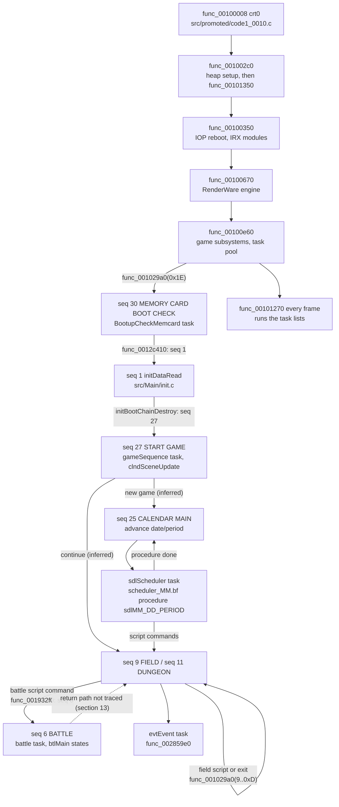

# Persona 4 engine architecture

This is a map of how the game's major systems fit together, traced from the
entry point through the recovered C. It is meant for someone who wants to
learn how Persona 4 works from this decompilation, and it is a starting point
for reading code, not a specification.

Every statement cites the file and function it was read from. Most of the
engine is still unnamed, so many citations are `func_XXXXXXXX` symbols; the
suffix is the function's retail address. Data that is not yet declared in C
is cited by its retail address (`0x5DCC20`) and was read from the retail
executable. Anything marked **[inferred]** is a reading of the code's shape
or of nearby evidence, not a traced fact. Section 13 lists the systems that
are still too unnamed to explain properly.

## 1. Reading conventions

A few idioms appear in almost every first-party file. Knowing them makes the
rest of the code much easier to read.

| Idiom | What it is | Where to see it |
|---|---|---|
| `func_0046d730(file, line)` | Assertion-failure hook. The retail body is empty, but callers still pass a source-file string and a line number. | `src/promoted/code1_0046.c` |
| `func_0046d740(msg, file, line)` | Assertion hook that also takes a message. Its body is empty too. | `src/promoted/code1_0046.c` |
| `chkmemAllocSiteTag(file, line)` | Allocation-site tag that callers issue before an allocation. Its body is empty. | `src/Kernel/sdkChkmem.c` |
| `func_00440b68(fmt, ...)` | Formatted debug output, for example `"Scene data load..."` in `fieldSceneLoad`. Still `INCLUDE_ASM`. **[inferred]** printf-like | `src/promoted/code1_0044.c` |
| `jtbl_008873E8[0](size, hint)` | Allocate | e.g. `src/Scene/resrcManager.c` `resrcMngCreate` |
| `jtbl_008873EC[0](ptr)` | Free | e.g. `resrcMngDestroy` |
| `D_008873F4[0](count, size, hint)` | Zeroing allocate (calloc) | e.g. `src/Main/sequence.c` `func_001028c0` |
| `*(u8 **)(task + 0x38)` | The task's work block (`SdkTask::work` in `include/sdktask.h`) | every task update function |
| `iGpffffXXXX` | A small global reached through `$gp`. Its address is `0x007690F0 + (XXXX - 0x10000)`. | e.g. `iGpffffb3ac` is the battle context at `0x76449C` |

The assertion hooks are why so many units have their original names. The
`__FILE__` strings survive in the data even though the hooks do nothing (see
`tools/tu_audit.py`).

The allocator slots at `0x8873E8..0x8873FC` are `.bss`, filled at run time.
`src/Scene/resrcManager.c`'s port comment identifies `0x8873EC` as
RenderWare's `RwFree` slot, and boot hands the game's allocator table to
`RwEngineInit` (section 2). **[inferred]** The slots follow RenderWare 3.7's
memory-function layout (malloc, free, realloc, calloc, then two free-list
slots at `0x8873F8`/`0x8873FC`) wrapped around the game heap.

## 2. Boot and the main loop

### Entry and C entry

`config/target.json` gives the entry point as `0x00100008`. That address is
`func_00100008` in `src/promoted/code1_0010.c`. It is Sony's `crt0` and stays
`INCLUDE_ASM`; the comment above it explains why. Among the addresses it
loads are the `$gp` value `0x7690F0` and the C entry, and its last call is
`func_001002c0`.

`func_001002c0` passes two strings to `func_00440b68` (debug output), calls
`func_00100230`, and enters `func_00101350`. `func_00100230` computes an
address from `0x02000000` (the top of the 32 MB of RAM) minus the image extent
and passes it to `func_0043ece8`. **[inferred]** That call initialises the C
heap.

`func_00101350` is the real `main`:

1. `func_00100350` reboots the IOP with `IOPRP310.IMG` and loads the IRX
   modules from `cdrom0:\LIB31\`, retrying each until it succeeds. The module
   names in `0x5DC560..0x5DC730` include `SIO2MAN`, `PADMAN`, `CRI_ADXI` and
   the sound drivers.
2. `func_00100670` starts RenderWare. It calls `RwEngineInit(func_0044f510(),
   0, 0x800000)`, where `func_0044f510` returns the game's memory table (slots
   `chkmemAllocate`, `chkmemFree`, `chkmemReallocate`, `chkmemAllocZeroed` in
   `src/Kernel/sdkChkmem.c`). It then attaches plugins
   (`RpUVAnimPluginAttach`, ...), calls `RwEngineOpen`,
   `RwEngineSetVideoMode(0x52)` and `RwEngineStart` (`func_003e8b10`,
   `func_003e8a10`, `func_003e8a50` in `src/renderware/`), and registers the
   `bmp` and `tmx` image formats through `func_003eb1f0`.
3. `func_00100e60` brings up the game: the task pool (`kwlnTaskInitPool(0x190)`,
   section 4), the CD and sound services (`func_004559b0` in `sdkCdvd.c`,
   `func_00458fa0` in `sdkSnd.c`), the Sofdec player (`mwPlyInitSfdFx`),
   `func_001939a0` (which calls initialisers in the battle address range),
   the script pools (`func_0029d950`), the two `mainDraw` tasks
   (`mainDrawStartClearOt`, `mainDrawStartFrame`), the sequence observer
   (`func_001028c0`) and the fade task (`func_00122430` in `src/fade.c`).
   It also calls `func_001029a0(0x1E, 0, 0, 0)`, which requests game
   sequence 30.
4. It seeds `RpRandomSeed` and `RpRandomSeedMT` from the timer at
   `0x10000000`, then calls `func_00101270` forever.

### The frame

`func_00101270` in `src/promoted/code1_0010.c` is one frame. In order, it
calls:

| Call | Owner | Role |
|---|---|---|
| `func_00454640` | `src/Kernel/sdkCdvd.c` | Services the queue of disc reads (section 5) |
| `func_0046ab40` | `src/promoted/code1_0046.c` | Walks a list at `D_00724C08` and updates each entry. **[inferred]** sprite attachments; neighbours are in `sdkSpr.c` |
| `func_0045b7c0` | `src/sdkSndcom.c` | Sound command service |
| `func_004594c0` | `src/sdkSnd.c` | Sound service |
| `func_00452ce0` | `src/promoted/code1_0045.c` | Updates the two 0x4A-byte records at `D_008C02E0`. **[inferred]** controller ports |
| `kwlnTaskRunFrame` | `src/Kernel/sdkTask.c` | Runs every task (section 4) |
| `func_00466580` | `src/h_sfdply.c` | Resumes the Sofdec movie thread when it is pending |
| `func_003e5510(1)` | `src/promoted/code1_003e.c` | Sets `D_00886700` |

`func_00101270` also increments two counters at `iGpffffb1a0` and
`iGpffffb19c`. Nothing is drawn directly in the frame function. Drawing
happens inside tasks (section 6).

## 3. Game sequences

A *sequence* is the top-level mode the game is in: field, battle, calendar,
title, a shop and so on. `src/Main/sequence.c` owns the switch:

- `func_001028c0` creates the **sequence observer** task. Its name string
  `"sequence observer"` is at `0x5DCB40`. It has priority `0xF`, update
  `func_00102780` and destroy `func_00102890`, the last two in
  `src/promoted/code1_0010.c`.
- `func_001029a0(id, data, size, delay)` requests sequence `id`:
  1. If a sequence is running and its *isRunning* callback still returns 1,
     the function calls that sequence's *end* callback.
  2. With `delay == 0` it calls the new sequence's *start* callback at once,
     passing `data`.
  3. Otherwise it copies `size` bytes of `data` into a fresh allocation, and
     the observer starts the sequence after `delay` frames.
- `func_00102780`, the observer's update, counts the delay down, calls
  *start*, and then polls *isRunning* every frame. When *isRunning* stops
  returning 1, the sequence id is reset to −1.
- `func_00102980` returns the current sequence id. Field code uses it to tell
  which mode it is in (`src/Kosaka/Field/k_field.c` `func_00155bf0`).

The sequence table is still raw data at `0x5DCC20`. Each `0x50`-byte record
holds `name[0x40]`, a word at `+0x40`, and the *start*, *isRunning* and *end*
callbacks at `+0x44`, `+0x48` and `+0x4C`.

The record layout comes from the `D_005DCC64/68/6C + id * 0x50` indexing in
`func_001029a0` and `func_00102780`. Nearly every *isRunning* callback is
"find the task by name". Nearly every *end* callback destroys that task.
Most of these callbacks live in `src/Kosaka/Field/sequenceList.c`
(the `Seq*` callbacks, from `SeqInitDataRead_End` to `SeqMovie_End`) and `src/promoted/k_sequence.c`.

| Id | Retail name | Start callback (owner) | Notes |
|---|---|---|---|
| 0 | (none) | `SeqDebugMenu_Start` (sequenceList.c), which calls the empty `func_00103590` | Polls for the `"debug menu"` task, which is stripped from retail |
| 1 | (none) | `func_00102b90`, which calls `initBootChainStart` (`src/Main/init.c`) | `initDataRead`: loads the init tables |
| 2–5 | FIELD (EVENT) VIEW, DUNGEON VIEW, DUNGEON EDITOR, LARGE MAP DEBUG | k_sequence.c | Viewer and debug modes |
| 6 | BATTLE | BATTLE sequence start callback: destroys the field resource archives (`K_Fldrc_DestroyArchives`), which calls `func_00192e90` and `func_00193730` (`src/promoted/code1_0019.c`) | See section 8. |
| 7 | SCRIPT VIEWER | `SeqScriptViewer_Start`, which calls `func_0029e8d0` (`scrScriptProcess.c`) | |
| 8 | EVENT | `SeqEvent_Start`, which calls the stub `func_002853b0` | |
| 9 | FIELD | `func_00170220` (`src/promoted/k_sequence.c`), which calls `func_00155e10` (`k_field.c`) | 0x1C-byte packet: field, room, entry, spawn, direction |
| 10 | TOOL EVENT | `func_00170350` | |
| 11 | DUNGEON | `func_001704a0`, which calls `func_00159e90` (`src/promoted/code1_0015.c`) | |
| 12 | LARGE MAP | `func_001707b0` | |
| 13 | FOOD COURT | `func_001708a0` | |
| 14–21 | KOSAKA, TOHYAMA (MOVIE), NIIDA, YAJI, NOWATARI, MIWA, IMANISHI (STAFF), SAMPLE | various | Per-programmer test entries. **[inferred]** These match the `src/Kosaka/` and `src/Yajima/` directory names. |
| 22 | WEAPON STORE | `SeqWeaponStore_Start`, which calls `func_002bdb50` (`src/Event/Fcl/y_fclShop.c`) | Polls `Y_FclShopMainProc` |
| 23 | ITEM STORE | `SeqItemStore_Start`, which calls `func_002e7510` | Polls `46ShopSystem` |
| 24 | COMBINE | `SeqCombine_Start`, which calls `func_00311260` (`src/Event/Fcl/y_fclCombine.c`) | Polls `Y_FclCombineTitleProc` |
| 25 | CALENDAR MAIN | `calendarOpenFlagClear` (`src/calendar.c`) | Section 10 |
| 26 | CALENDAR (RESTART) | `calendarOpenFlagSet` (`src/calendar.c`) | |
| 27 | START GAME | `gameSequenceStart` (`src/Main/gameSequence.c`) | Task `"gameSequence"` with update `clndSceneUpdate` |
| 28 | NAME ENTRY | `func_00103510`, which calls `func_002a2650` (`src/nEntry.c`) | |
| 29 | MOVIE | `SeqMovie_Start`, which calls `func_0046a110` | Also requested by a script command in `src/Script/scrCommonCommand.c` |
| 30 | MEMORY CARD BOOT CHECK | `SeqMemcardBootCheck_Start`, which calls `func_0012c460` (`src/promoted/code1_0012.c`) | Task `"BootupCheckMemcard"` |

### Boot chain

1. Init requests sequence 30. `func_0012c460` creates the
   `BootupCheckMemcard` task; its destroy callback `func_0012c410` requests
   sequence 1.
2. Sequence 1 runs the `initDataRead` task (`src/Main/init.c`
   `initBootChainStep`). It calls three step callbacks from `0x5E46D0` in turn
   (`initDataReadStart`, which reads `init/itemtbl.bin` into `D_0079BF00`;
   `func_0012d320` in `src/Camp/cmpMain.c`; `func_0015e7d0` in
   `src/promoted/k_fldData.c`), each returning a task, and waits for each
   task to reach the dying state. Then `initBootChainDestroy` requests sequence 27
   with a 5-frame delay.
3. Sequence 27 runs `clndSceneUpdate` in `src/promoted/code1_0012.c`, which
   either requests sequence 25 (calendar) or resumes at a saved location
   through sequence 9 (field; `D_0079B698`/`D_0079B69C` are field and room)
   or sequence 11 (dungeon; `D_0079B6A0`). **[inferred]** These correspond to
   the title menu's new-game and continue choices.

## 4. The task kernel

Everything that runs per frame is a task. The kernel is
`src/Kernel/sdkTask.c`. The P3 FES names `kwlnTask*` in
`config/symbol_names.p3.txt` belong to it, and the kernel functions use them: `kwlnTaskGetTaskByName` and `kwlnTaskDestroyWithHierarchy`. Note
that `src/Kernel/kwlnTask.c` itself holds two camera helpers, not the kernel.

### The task object

The object is `struct KwlnTask` in `sdkTask.c`, `0x54` bytes. A smaller
public view, `SdkTask`, is in `include/sdktask.h`. The fields that matter:

| Offset | Field | Meaning |
|---|---|---|
| `0x00` | `name[0x18]` | Inline name; tasks are found by name |
| `0x18` | `nameSum` | Sum of the name bytes, compared before `strcmp`-style matching in `kwlnTaskGetTaskByName` |
| `0x1C` | `flags` | Low nibble is the list state (1 starting, 2 active, 3 dying). Bit `0x20` skips updates. Bit `0x10` gives the task a neutral input block (zeroed, with `0x80` in the analog fields). |
| `0x20` | priority | Sort key; lower runs first |
| `0x2C` / `0x2E` | start delay / free delay | Frames spent in the starting and dying lists. The free delay is at least 2. |
| `0x30` | update | `SdkTaskUpdate`, `s32 (*)(u8 *task)` |
| `0x34` | destroy | `SdkTaskDestroy` |
| `0x38` | `work` | Caller-owned work block |
| `0x48`/`0x4C`/`0x50` | parent / first child / next sibling | Task hierarchy |

### Creation

`kwlnTaskCreate(name, priority, startDelay, freeDelay, update, destroy, work)`
creates a task; the prototype is in `include/sdk_task_registration.h`. It
allocates the object from the pool built by `kwlnTaskInitPool`. That pool is
`RwFreeListCreateAndPreallocateSpace(0x54, 0x190, ...)`: 400 task slots. The
symbol is `func_003e1220`, which `src/renderware/core/bacamera.c` `#define`s
to the RenderWare name.

A task with no start delay goes straight onto the active list.
`kwlnTaskCreateChild(parent, ...)` does the same and then links the new task under
`parent` with `kwlnTaskAddChild`.

### Running

`kwlnTaskRunFrame` is the per-frame entry. It runs in three passes:

1. Counts down start delays and moves tasks whose delay has expired onto the
   active list.
2. Calls `kwlnTaskRunList`, which walks the active list in priority order. For
   each task, `kwlnTaskRunUpdate`:
   - prepares the 0x94-byte input block at `D_008C0240`, copied from
     `D_008C02E0`, or neutral when flag `0x10` is set
   - calls `update`
   - increments the frame counter at `0x28`, which `kwlnTaskGetTimer` reads
3. Counts down free delays on the dying list and finalises tasks whose delay
   has expired (`kwlnTaskFinalize`).

The update's return value drives the task:

| Return | Effect |
|---|---|
| `0` | Keep running |
| `-1` | End the task: move it and its children to the dying list (`kwlnTaskMoveToDying`, `kwlnTaskKillSiblingChain`) |
| Any other value | Becomes the new update function, so a task can switch state by returning the next handler |

### Lifetime

`kwlnTaskDestroyWithHierarchy` moves a task and its
children to the dying list. When the free delay reaches zero,
`kwlnTaskFinalize` ends the task's children, unlinks the task, calls `destroy`
and returns the slot to the free list.

`kwlnTaskGetState` reports a task's list state. `kwlnTaskIsLinked(task)` returns 1
while the task is still on any list, which is how callers poll for a task to
finish. `init.c` and `calendar.c` wait instead for a child to reach state 3.
`kwlnTaskDumpAll` prints the task tree, and is a useful reference for the list
globals.

### Priorities seen in this document

`0x0A` mainDraw "clear ot"; `0x0F` sequence observer, field root, evtEvent;
`0x10`/`0x11` battle and its draw children; `0x98`/`0x99` fadeCalc and
fadeDraw; `0xC8` mainDraw(drawOt); `0x100` gameSequence, Calendar,
initDataRead, sdlScheduler and ItemTblDataRead.

## 5. Memory, resources and disc loading

### Heaps

`src/Kernel/sdkChkmem.c` is the checked allocator that RenderWare is given
at boot; `chkmemAllocate` rounds sizes up and keeps the allocation count and
byte total in `D_00763D1C`. `src/promoted/code1_0046.c` `func_0046a430` is a
second allocator (the `sdkMalloc.c` strings at `0x756748`) that hands out
16-byte-aligned blocks from a slot table at `iGpffffbb14`;
`src/Kernel/h_malloc.c` `H_Calloc` wraps it. The rest of `h_malloc.c` is
unrelated GS texture-upload packet builders (`func_00143ba0`..`func_001441a0`).

### The scene and its resource lists

The current scene is the `MtScene` object at `iGpffff9db0` (`0x762EA0`),
typed in `src/Scene/mt_scene.c` as `fldMajorId`, `fldMinorId` and
`resManager` (offsets 0, 4 and 8). `src/promoted/code1_0014.c`
`fieldSceneLoad(major, minor)` loads a scene. If that major/minor is already
loaded it prints `"Scene data cashe hit!!"` and reuses it. Otherwise it frees
the old scene (`func_00145080`, which calls `resrcMngDestroy`), creates a new
manager with `resrcMngCreate`, and creates the default character and NPC
lights (`MT_Scene_CreateResLightChar`, `MT_Scene_CreateResLightNpc`). The
pack file name is built by `func_00144b80` from `"field/pack/f"`, `"%03d"`,
`"_%03d"` and `".p01"`.

`src/Scene/resrcManager.c` keeps one doubly linked list per resource type
(`ResrcManager::resLists[22]`). A resource id is a `u16`: the low 10 bits are
the id and the upper bits are the `ResrcType` (`RESRC_TYPE_MODELCHAR = 1`,
`RESRC_TYPE_FLD`, `RESRC_TYPE_FLDHIT` and so on, from
`include/resrc_manager_internal.h`). `resrcMngCreateRes` allocates a record
of the type's size and links it; `MT_Scene_GetRes(resTypeId)` finds one; and
`MT_Scene_GetResListHead(type)` returns a type's first record, for walking
the `next` link at `0x138`.

Callers include battle (`src/Battle/battle.c` `btlFindFreeCharResId`, which
probes ids `0x400|n`), the field (`k_field.c` `func_00155360`), events
(`src/evtScript.c`) and social-link screens (`src/cmmRankUp.c`).

### Disc loading

`src/Kernel/sdkCdvd.c` `func_00454a60(path, mode)` returns an `HCdvd`
request. It upper-cases the path, resolves it against the volume directory
table `D_007107b0` in `src/h_cdvd/h_cdvd.c`, and links a `0x364`-byte node
into the list at `D_008D1B80`. A path that is already queued is shared and
reference-counted at `0x35A`.

`func_00454640`, called first in every frame, advances each node's
`readState`. It opens the file through CRI's ADX file system (`ADXF`
handles; `func_004c85a0` and friends in `src/cri/`), allocates
`fileMemory`, and reads.

Callers poll `H_Cdvd_IsFileLoaded`, or block with `H_Cdvd_ReadSync`, read
the data at `+0x110` (pointer) and `+0x118` (size), then release it with
`H_Cdvd_Destroy`. All three are in `src/h_cdvd/h_cdvd.c`. `src/Main/init.c`
`initDataReadStep` is the smallest complete example.

## 6. Rendering

The game renders through RenderWare Graphics 3.7. `src/renderware/` is the
ported source; `src/rw/` holds other attributed RenderWare functions and the
PS2 "sky" driver. `wiki/RenderWare.md` explains the split.

### The ordering table

Each frame is bracketed by two tasks created in `src/Main/mainDraw.c`:

1. **`"clear ot"`**: `mainDrawStartClearOt`, priority `0x0A`, update
   `mainDrawClearOtUpdate`. It flushes debug print (`H_Dbprt_Flush`), clears the
   camera (`RwCameraClear`), resets the ordering table at `D_00793E80`
   (`func_00460a80`; `0xD8` buckets of `0x30` bytes), and installs fixed
   render-state callbacks (`func_001015c0`..`func_00101a80`) into specific
   buckets.
2. Game tasks then append draw nodes to buckets. `src/sdkOt.c`
   `func_00460ac0(bucket, node)` appends a node; `func_00460b60` allocates a
   node with a callback and an argument. For example, battle registers
   `func_001927c0` and `func_001928c0` into buckets `D_007940C0` and
   `D_00794120` (`src/Battle/battle.c` `func_001926c0`).
3. **`"mainDraw(drawOt)"`**: `mainDrawStartFrame`, priority `0xC8`, update
   `mainDrawFrameUpdate`. It brackets the walk with the camera's begin/end-update
   (`func_003e8120` and `func_003e8110` in `src/rw/bacamera.c`, which call
   camera slots `0x18` and `0x1C`). In between it calls `sdkOtFlushBuckets` (was `func_004623a0`) on
   each of the `0xD8` buckets in order.

**[inferred]** The function table at `D_00887300` is RenderWare's
render-state setter. Every draw callback calls it as `(state, value)`, next
to `RpSkyRenderStateSet`.

### Models

`src/Graphics/Model/mdlManager.c` is the model layer over RenderWare clumps
and `RpHAnimHierarchy` animation, ported in part from P3 FES; its named entry
points so far are `mdlGetClump`, `mdlGetClumpFrame`, `mdlGetMatrix`,
`mdlScale` and `mdlSetColor`. `src/Graphics/Model/mdlApp.c` `func_00230f20`
picks the file for a model by type and id, including date-dependent
variants (`datGetFlag`, `func_001060b0`), and queues it with `func_00454a60`.
`include/model_callbacks_internal.h` documents the callback set that
`mdlSetModelCallbacks` (was `func_0047d090`) registers with the model layer. Field scripts create models
through `src/Kosaka/k_command.c` `K_Cmd_CREATE_MDL` and
`K_Cmd_CREATE_FLD_MDL`.

### Effects

The `eff*` units in `src/Graphics/Effect/` implement effect primitives:
particles, polygon flash, ring, thunder, track, wind, line nova, blur filter
and others. `include/effect_instance_internal.h` lists the per-kind
constructors (`EffectInstanceConstructor`). `effBlurFilter.c` shows the
full family pattern by name: `effBlurFilterDirectCreate`, `...Instantiate`,
`...Destroy`, `...Dispatch` and so on.

`src/Graphics/Model/mdlEffect.c` keeps effect instances attached to models
in linked lists (`mdlEffectListCreate`, `mdlEffectListInvokeEach`,
`mdlEffectRenderFlares`). `src/Graphics/Effect/tnEffect.c` holds the
effect-side render-state wrappers (`TnDispatchObjectCallback` (was `func_004815b0`)..`TnDispatchPairedDraw` (was `func_004818c0`)) and
`TnInitModule` (was `func_00481a20`), the setup function that boot (`func_00100e60`) calls
with `0xC7`.

**[inferred]** `effect/effpack.bin` is the effect pack. The string is in the
retail data at `0x713280` and is not traced to a loader here.

## 7. Field

Most field code is in `src/Kosaka/` and `src/promoted/k_*.c`. The `K_`/`k_`
prefix comes from the original file names.

### Entering a field

Sequence 9 calls `func_00170220` in `src/promoted/k_sequence.c`, which
passes the 0x1C-byte field packet to `func_00155e10` in
`src/Kosaka/Field/k_field.c`. That creates the **`"field root"`** task
(priority `0xF`, update `func_00155360`, destroy `func_00155bf0`) with a
`KFieldStateWork` block (`field`, `room`, `entry`, `spawn`, `direction`,
`loadTask`, `eventTask`, `scriptTask`, `transition`). `func_00155360` is the
field's state machine:

| State | What happens |
|---|---|
| 0 | Event-driven entry. Reads the field and room from an event reader (`func_00293fc0`/`func_002940a0`). |
| 1–3 | `func_00156640` (`src/promoted/code1_0015.c`) starts the child task `"setup field resource"` (`func_001561a0`). That task loads the scene through `fieldSceneLoad` and the field script. State 3 waits for it. |
| 4–5 | For fields `0x2C`..`0x44`, loads an extra field model (`mdlCreateModelObjectFromData`, was `func_00477e80`) and in state 5 positions it (`func_0015a350`, `mdlTranslateMatrix`, was `func_0047a180`). Calls `func_0016ea40` and `func_0016f130`. In event mode, starts the event instead (`func_002859e0`) and goes to state 14. |
| 6–8 | Waits on `func_001227f0`, starts the room's script as a task (`func_0029da90`), and loads room data (`func_0015c590`). |
| 9–10 | Creates field units (`func_001664a0`/`func_001662d0`, `func_00166b40` in `k_fldUnit.c`), the minimap (`smapCreateSymbols`, `func_002ae630` before the rename, in `src/Yajima/y_smap.c`) and other field tasks, then fades in (`func_00122640`). |
| 11–12 | Runs the room's entry script procedure (`func_0029db50`) and waits for it. Then starts `func_00174ad0` (`k_fldEvent.c`) and `func_0018df60`. |
| 13 | **[inferred]** Normal play. Waits for `exitRequested`. |
| 14 | Event mode. Waits for the event task to finish. |
| 17 | Field-to-field transition. After the fade, requests sequence 9 again with `work->transition`. |
| 18 | Returns −1. The task ends and `func_00155bf0` tears the field down. |

The teardown, `func_00155bf0`, also checks `func_00102980()`. When the next
sequence is not 9, 10 or 11, it releases more state (`func_001622d0`).

### NPCs, units and events

`src/promoted/k_fldUnit.c` owns field units, including ones that carry an enemy group;
`func_00163990` builds an encounter group for a unit with
`datUnitCreateEncounterGroup`. `src/Kosaka/Field/k_fldAI.c` holds follower
movement (its "Field follower update" comment). `src/promoted/k_fldEvent.c`
describes field event records as `0x2C` bytes in a table at
`func_00155280() + 0x18DC`, and `src/Kosaka/Field/k_event.c` has the
trigger geometry tests `K_FldEvent_IsPosWithinFov` and
`K_FldEvent_ArePosWithinDist`. `src/Kosaka/k_encount.c` picks encounters;
its header comment documents the tables it reads, two of which (`0x764508`,
`0x76450C`) are destinations in the `battle/ENCOUNT.TBL` loader record
(section 11). **[inferred]** `src/promoted/k_fldNpcTable.c` holds the NPC
tables.

### Field to battle

The only call that requests sequence 6 is `src/promoted/code1_0019.c`
`func_001932f0`. It is entry 220 of script command group 2 (the battle
group, section 9; the table entry is at `0x63DCC0`). It builds a 0x3C-byte
battle packet with the party units (`datUnitCreatePc(1)` plus
`datGetPartyId`), the enemy group (`datUnitCreateEncounterGroup(id)`, where
`id` is the script argument) and the battle field (default `0xF0`, 1).

It then calls `func_001029a0(6, packet, 0x3C, 4)`. Switching sequence calls
the FIELD record's *end* callback, `func_001702c0`, which destroys the field
root, so the field is torn down while the battle runs. **[inferred]**
Dungeon-contact and story battles therefore both reach battle through a
script procedure. The path from a shadow touching the
player to that procedure is not traced yet.

## 8. Battle

### Battle task and frame

Sequence 6 calls `func_00192e90` in `src/promoted/code1_0019.c`, which:

- allocates the 0xE88-byte battle context at `iGpffffb3ac` (`0x76449C`,
  also referenced as `D_0076449C`) in `func_00192b90`, which also resets
  the subsystems and enters btlMain state 1 through `func_001b60a0`
- creates the `"battle"` task (priority `0x10`, update `func_00192610`)
- creates two children, `"battle_draw_3d"` (`func_001926c0`) and
  `"battle_draw_2d"` (`btlUpdateDraw2DTask`, its update callback)
- copies the 0x3C-byte packet to `+0xC70`

`func_00192610` in `src/Battle/battle.c` is the battle frame. While context
flag 1 is set, it runs the subsystems in order. `func_001b5fe0` (the main
state machine) and `func_001b0a60` (the actions) come first; the rest are
still unnamed. Otherwise it calls `func_00192ae0`.

`func_00192cd0` frees everything when the battle task dies, including the
`DatUnit` groups at `+0xC74`, `+0xC84` and `+0xC94`.

### btlMain state machine

`func_001b5fe0` (`src/promoted/code1_001b.c`) runs a table-driven state
machine:

- The current state is at `+0x2FC`, the next state at `+0x300` and a frame
  counter at `+0x304`.
- When a next state is pending, the function calls that state's *enter*
  function.
- It then calls the current state's *update*. A non-zero return becomes the
  next state.

The table is at `0x5F7180`. Its `{enter, update, name}` records carry the
retail state names:

| # | Name | Update | # | Name | Update |
|---|---|---|---|---|---|
| 1 | NON | `func_001b18d0` | 11 | WIN | `func_001b5300` |
| 2 | INIT | `func_001b1940` | 12 | ENEMY DEAD | `func_001b47a0` |
| 3 | SCENE_SET | `func_001b19c0` | 13 | LOSE | `func_001b5620` |
| 4 | CONTINUOUS | `func_001b1b30` | 14 | FADE_OUT | `func_001b57f0` |
| 5 | UNIT_CREATE | `func_001b2380` | 15 | END | `func_001b5d30` |
| 6 | UNIT_LOAD | `func_001b36b0` | 16 | RESULT | `func_001b5db0` |
| 7 | START | `func_001b3870` | 17 | EXIT | `btlMainUpdateStateExit` (`src/Battle/btlMain.c`) |
| 8 | ACTION | `func_001b3a00` | 18 | TEST | `func_001b5ed0` |
| 9 | REVIVAL_MES | `func_001b3fb0` | 19 | MC | `func_001b5f30` |
| 10 | REVIVAL | `func_001b4630` | | | |

`func_001b60a0` enters state 1 (NON). RESULT waits for the result task stored at
`+0xDD0` and returns `0x11` (EXIT). EXIT clears context flag 1 once
`func_00193c70` and `func_001f6290` report idle.

The result screens are `src/Battle/btlResultSimple.c`,
`btlResultHeroLvUp.c` and `btlResultFriendPsLvUp.c`, plus
`src/Main/Battle/Result/brp_param.c`.

### Units

There are two layers:

- **`BtlUnit`** (`include/btl_unit_internal.h`) is the on-screen unit:
  position, rotation, colours, bounding sphere, look-at state and
  `charId`, followed by a large unnamed span. At `0xA64` it points to its
  `DatUnit`, and `0xA68`/`0xA6C` link the battle's unit list.
  `src/Battle/btlUnit.c` and `btlUnit_functions.c` hold the setters and the
  packet constructors (`btlUnitCreateMovePacket`,
  `btlUnitCreateRotatePacket`, `btlUnitCreateAnimPacket`, ...).
- **`DatUnit`** (`include/datUnit_internal.h`) is the `0x30`-byte stat
  record: `id`, `level`, `hp`, `sp`, `bad` (status ailments) and
  `aiTactic`. `src/Main/Battle/Data/datUnit.c` creates player records
  (`datUnitCreatePc`) and encounter groups of up to six enemies
  (`datUnitCreateEncounterGroup`, `datUnitGroupIsDefeated`).
  `src/Main/Battle/Data/datCalc.c` reads and modifies them (`datCalcGetHp`,
  `datCalcSetBadStatus`, `datCalcIsDead`) and holds the damage formula
  helpers (`datCalcFormula*`).

### Packets

Visible battle work is queued as **packets**. `func_00194470(type,
workSize)` allocates one; the header has `init`, `update` and `destroy`
slots at `0x68`, `0x6C` and `0x70`, and the work block at `0x78`.
`func_00194590(packet, queue)` stamps a UID (`btlGetUID`), calls `init` and
links the packet into queue `queue` at context `+0x198`.
`btlCreateSetFlagsPacket` in `battle.c` is the smallest example.

### Actions

Each acting unit has a `BtlAction` (`include/btl_action_internal.h`). The
fields are `uid`, `currState`/`pendingState`/`oldState`, `stateTimer` and
`unit`; `next` at `0x450` links the actions at context `+0x174`.
`func_001b0a60` walks that list every frame, applies delayed transitions and
calls the current state's update. `btlActionSetState` and
`btlActionSetStateWithDelay` (`src/Battle/btlAction.c`) switch states
through the table `D_005f6e20` (`{init, update, name}`).

The retail names of the action states:

> NON, STANDBY, START, START HOME, CHANGE FORMATION, COMMAND, TARGET,
> ANALYZE, AI, AUTO, SUPPORT, BAD, COOPERATE, PURSUIT_MES, PURSUIT, READY,
> MOVE TARGET, MOVE HOME, ATTACK, SKILL, SUMMON, ASSIST, EVENT, ERROR,
> ENDURE, WAIT, PERSONA, BAD DAMAGE, ESCAPE_MES, ESCAPE, ROUNDUP_MES,
> ROUNDUP, PACKET, END, END HOME, DEAD, EXIT, TEST

Only a few update functions are named. COOPERATE's update is
`btlActionCooperateUpdate` and ASSIST's is `btlActionAssistUpdate`, both in
`src/promoted/code1_001a.c`.

### Targeting

`src/Battle/btlTarget.c` (0x1EA9A0..) holds target selection; it is partly
ported from P3 FES and unnamed. `include/btl_skill_target_internal.h`
declares the skill-target classifiers `func_001d7f10`, `func_001f11e0` and
`func_001f1210`.

### AI

Script command group 2 (section 9) has 276 entries, 187 of them in
`src/Battle/btlAICommand.c`. **[inferred]** Enemy AI therefore runs as
flow-script code calling these commands. The named condition predicates
are split between `src/Battle/btlCond.c` (`btlCond_MYHP`, `btlCond_ENWEAK`,
`btlCond_ESCAPE`, ...) and `btlAICommand.c` (`btlCond_MYABLESKIL`,
`btlCond_ANALYZE`, ...). `include/btl_cond_internal.h` documents the FR
(friend) and EN (enemy) wrappers that pass a predicate to `func_001d94d0`.
The condition table at `0x609850` pairs each predicate with its retail name
string ("MYHP", "MYMP", ...).

### Camera

`src/Battle/btlCamera.c` runs camera "acts" from the table at `0x5F74E4`.
It has 50 `{name, start, update, ...}` records with retail names such as
NOP, ENCOUNT, ATTACK_SHORT, SKILL_EXEC_ONE, PERSONA, TARGET, WIN_P and
PURSUIT. The named handlers are `btlAct_TARGET`, `btlAct_SKILL_EXEC_ONE`,
`btlAct_WIN_P` and others. `docs/Battle_camera_sequence_20261005.md` covers
the camera sequence data.

The `btlShuffle*` units (0x36D990..0x38DCC0, 176 functions, all unnamed)
are **[inferred]** the post-battle card shuffle.

## 9. Events, scripts and facilities

### The script VM

Scripts use Atlus's flow-script format. `src/Script/scrScriptProcess.c`
types the header as `ScrHeader`, with magic `"FLW0"` and five content
sections: procedures, labels, instructions, messages and strings.

**Running a script.** A script runs as a task named after its procedure.
`func_0029d9b0` and its wrappers create the task; section 7 uses
`func_0029da90` for a loaded script buffer and `func_0029db50` for raw memory
plus a size. The task's update, `func_0029d870`, calls the interpreter once
per frame; `scrDestroyTask` releases the script; `scrFindPrcdIdxByName`
resolves a procedure index by name.

**The interpreter.** `src/Script/scrTraceCode.c` is a stack machine
(`ScrData`: `pc`, `sp`, 48 typed stack slots, and local ints and floats).
`func_0029cb00` dispatches up to 35 opcodes through `D_0063E2B0`: the
push/pop helpers `func_0029a050`..`func_0029ab80`, calls and jumps
(`func_0029b020`..`func_0029b170`) and the arithmetic and comparison
`CodeFunc_*` functions. An opcode returns *stop*, *next* or *yield*; yield
ends the frame.

**Commands.** The `COMM` opcode, `func_0029ad40`, calls a native command.
The operand's top bits pick a group; the table of `{commands, count}`
pairs is at `D_00748530`. Each command entry is `{function, paramCount}`.
Commands read their arguments with `scrGetParamInt` (int), `scrGetParamFloat`
(float) and `scrGetParamString` (string), and return a value with
`scrSetReturnInt`/`scrSetReturnFloat`. Returning 0 makes the script yield and
retry the command next frame.

| Group | Table | Entries | Main owners |
|---|---|---|---|
| 0 | `0x63D070` | 121 | `src/Script/scrCommonCommand.c` (`scrCommand_WAIT`, ...), `src/itfMesManager.c`, `code1_0025.c`, `code1_0029.c` |
| 1 | `0x63D440` | 51 | Field: `src/Kosaka/k_command.c` (`K_Cmd_CREATE_MDL`, ...), `code1_0017.c` |
| 2 | `0x63D5E0` | 276 | Battle and AI: `src/Battle/btlAICommand.c`, `code1_001e.c`, `code1_0019.c` |
| 3 | `0x63DE80` | 61 | Social links: `src/cmmScript.c`, `code1_0024.c`, `src/evtScript.c` |

**[inferred]** Most mode changes come from script commands: the group 0
handlers `K_Cmd_CALL_TV`..`func_001766e0` in `src/promoted/code1_0017.c`
request sequences 9, 10, 11, 12, 13 and 25.

### Events

`src/Event/evtEvent.c` `func_002859e0(major, minor)` creates the
**`"evtEvent"`** task (priority `0xF`). It then creates an event player
object (`evtStart`) and passes it the event id with `evtSetId`,
both in `src/promoted/code1_0028.c`. The task's update, `func_002857c0`,
advances the event one frame at a time until the frame counter at `+0x14`
reaches the length at `+0x10`. It calls `func_0028aaf0` (`src/Event/evtMain.c`)
when the frame changes and `func_0028c3f0` (`code1_0028.c`) every frame, and,
when the event has a message, updates it through `func_002909a0` and
`func_00290bc0` in `src/Event/evtMessage.c`.

`evtMain.c` holds the per-command event handlers (`func_00288170` and
`func_00288af0` take `(action, frame, event, resource, command)`).
`evtModel.c`, `evtMessage.c`, `evtEffect.c`, `evtLoadSave.c` and
`evtPMFileReader.c` cover the event's subsystems, and `src/Event/mt_evt*.c`
hold the scene-side helpers. Almost all of these are unnamed. So are the
dialogue and message windows (`src/itfMesManager.c`, 85 functions, and
`src/itfMsgProcedure_Window.c`) and the font renderer (`src/frFont*.c`).

### Facilities (`fcl`)

`src/Event/Fcl/` holds the facility screens: shops (`y_fclShop.c`,
`y_fclShopDraw.c`, `y_fclItemShopDraw.c`), fusion (`y_fclCombine*.c`,
`fclCombineMisc.c`), talk (`y_fclTalk.c`), and shared slots and fades
(`fclBankManager.c`: `fclBankAcquire`, `fclBankUpdateFades`; `fclMisc.c`:
`fclMiscAcquireHandle`, ...). They are entered as sequences 22–24
(section 3). Fusion's card and ball effects are in
`src/Event/y_CmbCardEff.c` (`cmbCard*`) and `y_fclCmbBall.c`.

## 10. Calendar and social links

### Date and time

The global game state lives in `src/g_data/g_data.c`. `D_00797B7A` is the
day index (read by `func_001060b0`), `D_00797B7C` is the time-of-day period
0..5 (`func_001060c0` reads it, `func_001062f0` writes it), and `datGetFlag`
reads the flag bits in `DatGlobal::flags`. The date helpers in
`src/promoted/code1_0011.c` convert a day index to month and day
(`func_001104d0`) and back (`func_00110600`), and give a month's length
(`func_001104a0`). `src/datCalendar.c` has `clndGetMoonPhase` (indexed by
days since 5 April) and `clndIsDateInRange`.

### The day loop

Sequence 25, **CALENDAR MAIN**, is `src/calendar.c` `calendarOpenFlagClear`. It
creates the `"Calendar"` task with update `func_00120f70` in
`src/promoted/code1_0012.c`, plus a `"CalendarDraw"` child. `func_00120f70`
advances time. Period 5 rolls over to period 0 of the next day. On days
where `func_00110d30(day)` is false the period increments; otherwise it
steps 0 to 3 to 5.

It then calls `func_00260450` in `src/cldScheduler.c` and ends.
`func_00260450` starts the **`"sdlScheduler"`** task, `func_00260020`:

1. Loads `scheduler/scheduler_%02d.bf` for the current month into a 0x20000
   buffer.
2. Finds the procedure `sdl%02d_%02d_%s`, built from month, day and one of
   the period labels `AM_A`, `AM_B`, `PM_A`, `PM_B`, `PM_C`, `PM_D`.
3. Runs that procedure as a script task (`func_0029da90`).
4. When the script finishes, requests sequence 25 again, unless bit 0 of the
   scheduler's flag word is set.

**[inferred]** The game's day is therefore driven by one script procedure
per date and period, and those procedures move the player into field,
dungeon, event and battle sequences through script commands (section 9).

`calendarInputUpdate` in `calendar.c` is an interactive date picker that requests
sequence 26 on a button press. **[inferred]** It is a debug tool.
`src/cldDayChange.c` and `src/cldDungeonIn.c` are further calendar units
and are unnamed.

### Social links (`cmm`)

`src/cmmCommunity.c` keeps the social link ("community") records in the
global block. `func_001070e0(id)` searches 21 records of `0x10` bytes at
`D_00797410` for link `id` (below `0x1F`); the rank is at `+6`, and rank 10
is special-cased (**[inferred]** the maximum). `func_00106f40` and
`func_00106db0` mirror a link's rank and state into per-link flags through
`func_00106390` (flag base `0x3FF + id`, in 32-flag strides).

`src/cmmScript.c` supplies most of script command group 3. `src/cmmMisc.c`
holds helpers, including `func_00248240`, which the scheduler calls when the
day changes. `src/cmmRankUp.c` (**[inferred]** the rank-up presentation),
`src/comuData.c` and `src/comuTimerSequence.c` are related units. All of
these are unnamed apart from the record layout above.

## 11. Persona and skill data

### Battle tables

Battle data comes from eight `.TBL` files loaded by `func_00193840` in
`src/promoted/code1_0019.c`. The task `"btlTableReload"`
(`func_00193a80`, `func_001939e0`) reloads them, and
`func_0010d480` in `g_data.c` runs after the last one.

The loader records are at `0x5F66C0` (`0xA4` bytes each). Each record has a
path, then `(destination pointer, size)` pairs. A file is a sequence of
size-prefixed segments padded to 16 bytes. Each segment is copied into the
arena at `D_007F17B0`, and its address is stored at the destination.

| File | Destinations | Known consumer |
|---|---|---|
| `battle/SKILL.TBL` | `0x7644A4`, `0x7644A8` | skill tables |
| `battle/UNIT.TBL` | `0x7644B4`, `0x7644B8`, `0x7644C8` | enemy unit data |
| `battle/MSG.TBL` | `0x76453C`, `0x764538`, `0x764534`, `0x764530`, ... | `DAT_00764530`, read by `datPersonaGetRow` (`0x11`-byte entries per persona id) |
| `battle/PERSONA.TBL` | `0x7644C4`, `0x7644CC`, `0x7644D4`, `0x7644D8` | `DAT_007644c4`, read by `datPersonaGetArcana` (`0xE`-byte entries per persona, 256 personas = `0xE00` bytes) |
| `battle/ENCOUNT.TBL` | `0x764504`..`0x764510` | `src/Kosaka/k_encount.c` |
| `battle/EFFECT.TBL` | `0x7644AC` | `iGpffffb3bc`, the four-byte skill flag records in `include/btl_skill_internal.h` |
| `battle/MODEL.TBL` | `0x7644B0`, `0x7644BC`, `0x7644D0` | |
| `battle/AICALC.TBL` | `0x7644E4`..`0x7644F0` | |

### Persona data

`src/Main/Battle/Data/datPersona.c` (58 functions,
`include/datPersona_internal.h`) is the persona table API. `datPersonaGetRow`
and `datPersonaGetArcana` look up per-persona rows by id, and `datPersonaCollectLearnableSkills`
lists a persona's learnable skills in its level range (its comment and
`docs/probe_archive/Persona_skills_00109510_20260922.md`). **[inferred]**
`datPersonaGetBuffedStat`..`datPersonaGetEquipStatBonus` are stat accessors and
`datPersonaGetExpForLevel(persona, level)` is the experience curve.

The player's persona stock is save data. Its named accessors are in
`src/g_data/g_data.c`: `datPersonaGetLevel`, `datPersonaGetNextExp`,
`datPersonaGetSkills`, `datPersonaAddToBonusStatByPcId`, and others.

### Persona and skill screens (`shd`)

`src/shdPersona.c` (104 functions) creates the persona UI tasks, whose names
come from the retail strings: `"shdPersonaStatusDraw"` (`func_001178a0`),
`"shdPersonaDispCtlDraw"` (`func_0011d1f0`), `"shdPersonaLvUpSeq"`
(`func_0011e8e0`) and `"shdPersonaSkillSelectSeq"` (`func_0011f5a0`).
**[inferred]** `src/shdSkill.c` draws skill lists (it uses `frFont`), and
`shd` units in general are shared display screens; `shdWindow.c`,
`shdMisc.c`, `shdScript.c` and `shdEffect.c` follow the same pattern. All
are unnamed.

## 12. Source tree map

`wiki/Repository-Layout.md` describes the repository as a whole. This table
maps the game systems to their directories.

| Path | Contents |
|---|---|
| `src/Main/` | Boot (`init.c`), sequences (`sequence.c`, `gameSequence.c`), frame drawing (`mainDraw.c`), logo/title (`logoDraw.c`, `titleVisual.c`), `Battle/Data/` (`datUnit`, `datCalc`, `datPersona`, `datScript`), `Battle/Panel/`, `Battle/Result/`, `OpEd/` (staff roll), `Social/` (persona-card models) |
| `src/Kernel/` | Task kernel (`sdkTask.c`), allocators (`sdkChkmem.c`, `h_malloc.c`), CD service (`sdkCdvd.c`), sprites (`sdkSpr.c`), memory card (`mc.c`, `h_memcard*.c`), and `Kwln/` |
| `src/Scene/` | `MT_Scene_*` (`mt_scene.c`, `mt_sceneFunc.c`) and `resrcManager.c` |
| `src/h_cdvd/` and `src/h_*.c` | The `H_` service layer: disc, fade, pad, sound, Sofdec playback, debug print |
| `src/Kosaka/` | Field and dungeon: `Field/k_field.c`, `k_fld*.c`, `sequenceList.c`, `k_clump/`, `k_command.c` (field script commands), `k_encount.c` |
| `src/promoted/k_*.c` | More `k_*` units whose original directory is not known |
| `src/Battle/` | Battle: `battle.c`, `btlMain.c`, `btlAction.c`, `btlUnit*.c`, `btlTarget.c`, `btlCamera.c`, `btlCond.c`, `btlAICommand.c`, results, `btlShuffle*.c` |
| `src/Event/` | Event player (`evt*.c`, `mt_evt*.c`), facilities in `Fcl/`, fusion card effects |
| `src/Script/` | Flow-script VM (`scrScriptProcess.c`, `scrTraceCode.c`) and common commands |
| `src/Graphics/` | `Effect/` (`eff*`), `Model/` (`mdlManager`, `mdlEffect`, `mdlApp`, `mdlFile`), primitives |
| `src/Camp/` | The pause ("camp") menu: `cmpMain.c`, `cmpEquip.c`, `cmpPersona.c`, `cmpSkill.c`, ... |
| `src/Yajima/` | Minimap (`y_smap.c`), lists, symbols, time limit, draw helpers |
| `src/g_data/` | Global and save data (`g_data.c`): date, flags, party, persona stock |
| `src/*.c` (top level) | Units with a recovered file name but no recovered directory: `calendar.c`, `cld*.c`, `cmm*.c`, `shd*.c`, `itf*.c`, `fr*.c`, `sdk*.c`, ... |
| `src/renderware/`, `src/rw/` | RenderWare 3.7 and the PS2 driver (`wiki/RenderWare.md`) |
| `src/cri/` | CRI ADX/Sofdec middleware (`docs/cri/`) |
| `src/sce/` | Sony SDK units |
| `src/middleware/` | ee-gcc runtime and other vendor units |
| `src/generated/` | m2c drafts. Not authoritative and not linked. |

### How file names were recovered

Three kinds of file header tell you how much is known about a unit:

1. `/* Original translation unit X.c (recovered from embedded __FILE__
   assert strings; see tools/tu_audit.py). */`: the name is retail's own,
   recovered from assertion strings. 125 files carry this header.
2. `/* Source unit: src/Dir/name_XXXXXXXX.c */`: the unit was named by
   `tools/tu_audit.py` from other evidence, mainly P3 FES cross-references
   and shared data. The suffix is its first function's address. 244 files
   carry this header. These are the "inferred units".
3. `src/promoted/code1_XXXX.c`: no name yet. Functions are grouped by the
   top bits of their address (`code1_0019.c` covers `0x190000..0x19FFFF`).
   These 67 files hold 5,243 function windows, of which fewer than a hundred
   have names. That makes them the largest unnamed area in the tree.

Ownership is per function. Each `// FUN_XXXXXXXX` marker places one function
at its retail address, so a named unit can own functions that sit between a
`code1_XXXX.c` file's functions. For example, `src/Battle/btlMain.c` owns
`0x1B5E60` (`btlMainUpdateStateExit`), while the other state handlers around
it are still in `src/promoted/code1_001b.c`. `CONTRIBUTING.md` explains the
rules for moving functions out of a promoted bucket.

### Headers

Shared declarations go in one **owner header** per unit or system, named
`include/<system>_internal.h`. Examples are `include/mt_scene_internal.h`
(`MT_Scene_GetRes`), `include/datUnit_internal.h` (`DatUnit` and its
accessors), `include/btl_unit_internal.h`, `include/btl_action_internal.h`,
`include/evt_internal.h` and `include/resrc_manager_internal.h`. Field
headers are in `include/Kosaka/`.

Many units still use local `extern` declarations instead. When a prototype
is shared, moving it into the owner header is the convention recent commits
follow. A few non-`_internal` headers are public APIs:
`include/sdktask.h`, `include/sdk_task_registration.h` and
`include/h_cdvd.h`. RenderWare and CRI headers are in `include/rw/` and
`include/cri/`.

Some files are empty (`src/mdlManager.c`, `src/Battle/btlOrder.c`,
`src/btlFormation/btlFormation.c`, `src/op_fade/op_fade.c`,
`src/Kosaka/k_footstep.c`, ...). Where a sibling exists, the code is there:
`src/Graphics/Model/mdlManager.c`, `btlOrder_grouped.c`,
`btlFormation_grouped.c`, `op_fade_grouped.c`.

## 13. Open gaps

These systems are traced only at their edges. Their internals are still
`func_XXXXXXXX` with raw offsets, so this document cannot explain them well.
They are the best targets for naming and typing work.

| System | Where | What is missing |
|---|---|---|
| Battle frame subsystems | `src/promoted/code1_001b.c`, `code1_0019.c`, `code1_001e.c`, `code1_001f.c` | Of the eleven updates called by `func_00192610`, only `func_001b5fe0` (main states) and `func_001b0a60` (actions) are identified. All btlMain state handlers and most btlAction state updates are unnamed and live in promoted buckets. |
| Return from battle | `code1_0019.c`, `src/cldScheduler.c` | No traced code requests field or dungeon after sequence 6. The scheduler script or the battle's caller presumably resumes, but this is not traced. |
| Field state and units | `src/Kosaka/Field/k_field.c`, `src/promoted/k_fldUnit.c` (42), `k_fldEvent.c` (26), `k_fldNpcTable.c`, `src/Kosaka/Field/k_fldAI.c` | No function names. The touch-a-shadow path to battle is not traced. |
| Events | `src/Event/evtMain.c` (48), `evtModel.c`, `evtMessage.c`, `src/promoted/code1_0028.c` | The event player object and its command handlers are unnamed. The EVENT sequence's start callback is a stub. |
| Calendar and social links | `src/calendar.c`, `src/cldDayChange.c`, `src/cmmCommunity.c` (39), `src/cmmScript.c` (51), `src/cmmRankUp.c`, `src/cmmMisc.c` (57) | Only `clndGetMoonPhase` and `clndIsDateInRange` are named. The social link record and flag scheme above is read from offsets. |
| Persona data | `src/Main/Battle/Data/datPersona.c` (58), `src/shdPersona.c` (104), `src/shdSkill.c` | No names. The persona/skill/MSG table layouts are only known from strides. |
| Messages and fonts | `src/itfMesManager.c` (85), `src/itfMsgProcedure_Window.c`, `src/frFont*.c` | Unnamed. |
| Rendering core | `src/Graphics/Model/mdlManager.c` (135, 6 named), `src/sdkOt.c`, the bucket flush `sdkOtFlushBuckets` (was `func_004623a0`) | The ordering-table bucket semantics and the meaning of the fixed bucket callbacks. |
| Effects | `src/Graphics/Effect/*` | Apart from `effBlurFilter*`, `effMisc*` and three `effAfter*` helpers, the effect families are unnamed. The effect pack loader is not traced. |
| Facilities | `src/Event/Fcl/y_fclCombine*.c` (118), `y_fclShop*.c` | Unnamed. |
| Battle shuffle and results | `src/Battle/btlShuffle*.c` (176), `btlResult*.c` | Unnamed. |
| Promoted buckets | `src/promoted/code1_*.c` | 5,243 function windows, fewer than 100 named. The init path, scene loader, battle frame and allocator are all here. |
| Main loop services | `func_0046ab40`, `func_00452ce0`, `func_003e5510` | The roles in the frame table above are inferred from neighbours. |
| Heap bootstrap | `func_00100230`, `func_0043ece8` | The heap layout is not traced. |
