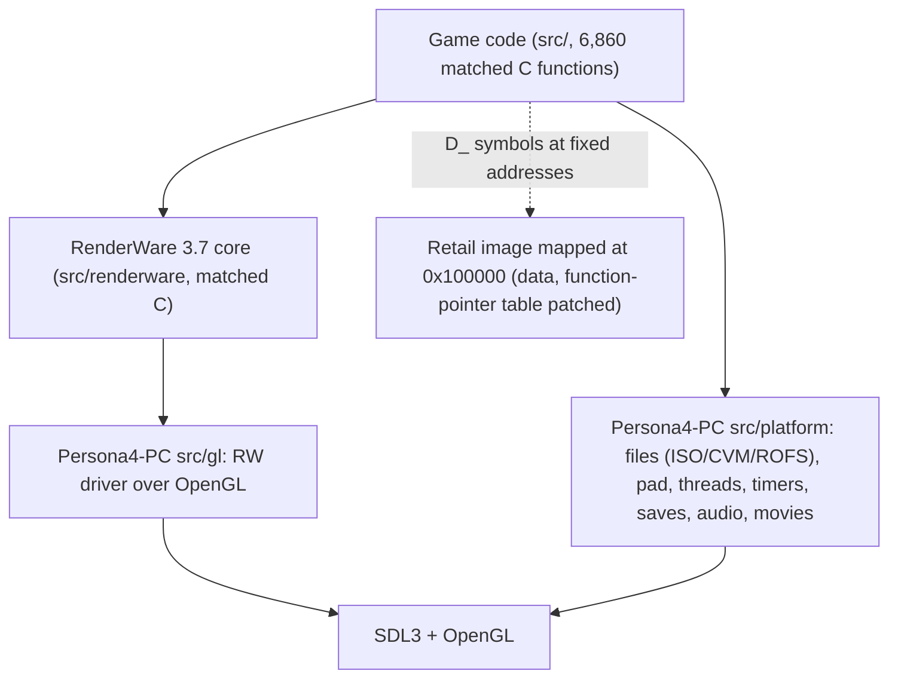

# PC port plan

A native PC port of Persona 4 (PS2, SLUS_217.82) built from this decomp, in the
style of re3 (GTA III rebuilt from source, with RenderWare's platform layer
replaced). The player supplies their own disc image; no game data is ever
distributed. The port lives in its own (private) repository,
`Raikaru/Persona4-PC`, which pins this decomp as a git submodule and never
edits it.

Phase 0 reports (all numbers in this file come from them):

- [host_build_census.md](host_build_census.md): compiling the C for a 32-bit PC, link surface, data mapping probe.
- [platform_surface.md](platform_surface.md): every PS2 library entry point the game code calls.
- [renderer.md](renderer.md): renderer options, disc layout and asset formats.

## Decisions

| Area | Decision | Why |
|---|---|---|
| Approach | Native: compile the decomp's C for PC, replace PS2-only layers | User choice; all 6,860 game functions are C |
| Platforms | Windows + Linux, SDL3 + OpenGL | User choice |
| Word size | 32-bit x86 first, 64-bit later | Game code and data store pointers in 32-bit fields; struct layouts stay PS2-shaped |
| Compiler | clang `--target=i386 -m32 -malign-double` | `-malign-double` reproduces MWCC's 8-byte `long long` alignment; clang also checks asm register names, which gcc does not |
| Data | Map the retail executable image at its original addresses (0x100000+); `D_` symbols are linker-defined absolute addresses; patch function-pointer words to native addresses at load | Data-to-data pointers stay valid unchanged (3,585 distinct targets, 0.4% named); only 2,398 words (2,013 distinct functions) need patching. Full data symbolization is not needed. `mmap(MAP_FIXED_NOREPLACE)` at 0x100000 measured working on Linux |
| Renderer | Keep the matched RenderWare 3.7 core (C, compiled for PC); replace only the sky2 PS2 driver with an OpenGL driver | RW core is 65,773 matched lines with 3 INCLUDE_ASM; the driver seam is the 11-slot `RwDevice` table plus raster/texture hooks; game render state goes through `RpSkyRenderStateSet` (685 sites, 4 state values in use). librw rejected: different API, no RpSky state, partial PS2 support |
| Assets | Read the player's ISO at runtime (CVM/ROFS containers), plus an override folder for replacement files | Model geometry on disc is generic RW (0 of 17,337 geometry structs are PS2-native), so no VIF decoding is needed; textures are TMX, already decoded by portable game code. A converter would duplicate the matched RMD loader |
| Platform layer | Replace at the game's own wrapper layer (`H_Cdvd_*`, `sdk*`, memcard, pad), not at the 213 raw SCE functions | Fewer, game-shaped entry points |
| Audio/movies | ADX/AHX decoded in-process; IOP sound driver commands reimplemented over SDL3 audio; Sofdec via pl_mpeg | The PS2's I/O processor modules are not part of the executable |
| Repository | Separate repo `Raikaru/Persona4-PC`; this decomp is a pinned submodule. PC replacements for individual functions are override files keyed by the `// FUN_` address, spliced over the original definition at build time; no `#ifdef P4_PC` in the decomp. Fixes correct for both builds (e.g. prototypes) land here through the normal gate | Keeps the matching sources readable and the decomp's CI about matching; a takedown of a playable port can't take the decomp with it |

## Milestones

1. **Host skeleton (Linux).** CMake project in the port repo; compat header (128-bit types as a 4×u32 struct, `mode(TI)`, MWCC keywords); every first-party and RW-core C file compiles for i386; loader maps `SLUS_217.82` from the player's ISO at 0x100000 and patches function pointers from a table generated from `config/symbol_addrs.txt`; every missing platform symbol is a logging trap. Done when the executable reaches `main` and runs until its first trap. Today 243 files (gcc) / 326 (clang) still fail with the shim; 1,540 of the clang errors are VU0 register names in 89 files.
2. **VU0 rewrite (parallel from milestone 1).** C (later SSE) equivalents for the VU0 inline asm (120 first-party functions in 43 files, 869 asm lines; clang flags VU0 registers in 89 files across the whole tree) and the `asm void` bodies (88 errors in 48 files), as per-address override files in the port repo.
3. **Platform basics.** ISO + CVM/ROFS reader behind `H_Cdvd_*`; threads/semaphores, VSync and timers on SDL3; pad on SDL3 gamepad/keyboard; memory card as save files. Done when boot reaches the title screen logic with no traps.
4. **Title screen.** GL driver for Im2D, TMX textures, `RpSkyRenderStateSet` ALPHA_1/TEST_1 as GL blend/alpha test, camera clear, present (`RwCameraShowRaster` → driver slot 20). Done when the title frame matches a PCSX2 capture by pixel diff.
5. **3D.** Atomics and world sectors from generic geometry, MatFX, skin/HAnim, toon, fog, particles. Same pixel-diff method against PCSX2 captures (the method sky2hook used).
6. **Audio and movies.** ADX/AHX streaming, the sound command set the game sends to the I/O processor, Sofdec movies.
7. **Windows, then 64-bit.** Windows needs a fixed-base `VirtualAlloc` at 0x100000 (not yet measured). 64-bit needs pointer-width fixes in data and structs and a different data strategy.

## Open questions

- Windows: whether 0x100000–0x2000000 is reservable in a 32-bit process.
- Meaning of the TXD/native-texture header words (6 and 1 on every texture; not the repo's PS2 platform ID).
- Where the sky2 driver registers raster slot 20 (the PS2 flip); not found by name.
- 157 RMD files (3%) that the phase-0 chunk walker did not parse.
- First-party prototype mismatches the host compilers report (`scrSetReturnInt`, `func_003d5830`, `kwlnTaskGetWork`): decomp fixes, each needs an owner verify.
